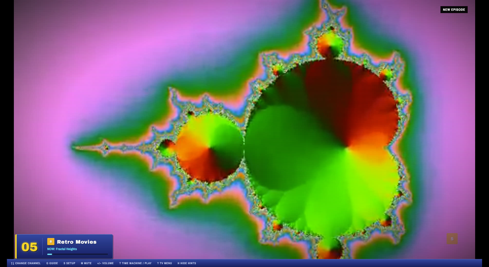
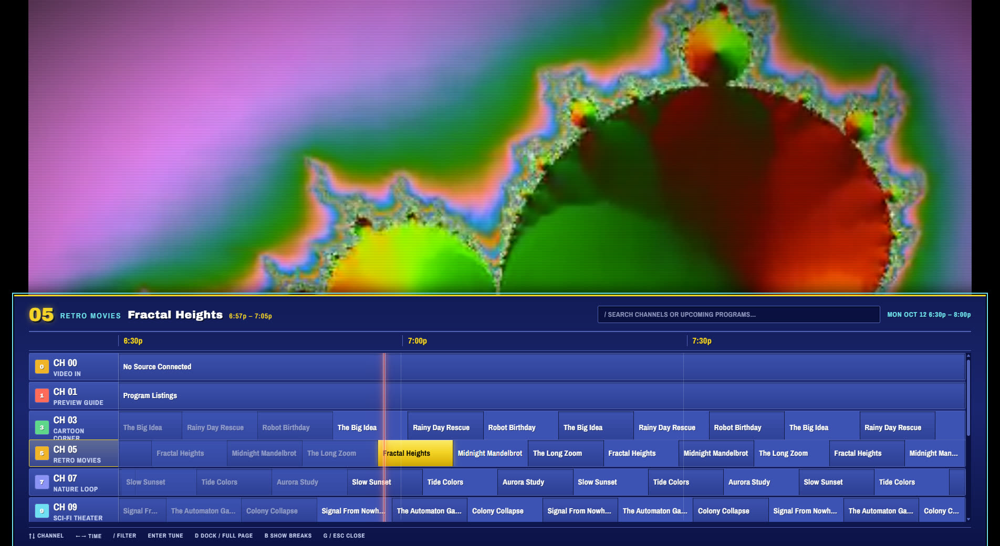
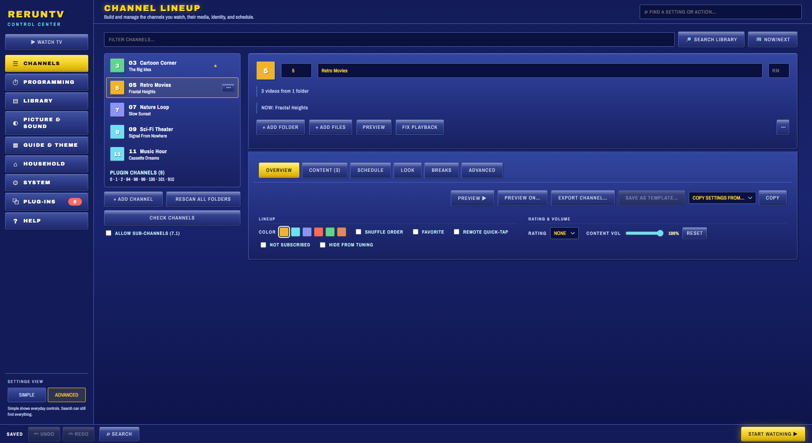
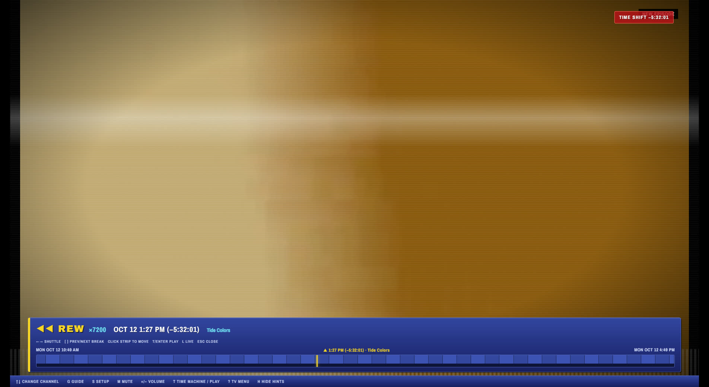

# RerunTV

[](https://github.com/Zhubbs19/RerunTV/actions/workflows/ci.yml)
[](LICENSE)

A desktop simulator of an old broadcast cable box. Point channels at folders in your own
media library, then surf channels like it's live TV — complete with CRT scanlines, screen
flicker, a channel-change static burst, and an early-2000s digital program guide.

**The signature feature:** channels are never "restarted." Each channel gets an anchor time
the moment you assign it, and whenever you tune in, the app calculates what *would* be
playing right now if that folder had been looping continuously since then — just like
flipping to a real channel mid-show. Nothing runs in the background; it's arithmetic
against the wall clock, so closing the app for a week costs nothing and the schedule is
still "correct" when you come back.

## Screenshots

Everything below is the bundled synthetic demo library (generated test video, see
[Try it without your own media](#try-it-without-your-own-media)). No real shows are shown.

| Live TV with the on-screen banner and CRT look | The program guide |
| --- | --- |
|  |  |

| Channel setup | Time machine |
| --- | --- |
|  |  |

## Try it without your own media

RerunTV ships no video, so here is a generated demo lineup (five channels of synthetic test
video and tones, nothing copyrighted). You need [ffmpeg](https://ffmpeg.org/download.html) on your PATH.

```bash
npm install
node scripts/make-demo-library.js demo-library
```

Then in the app open Channel Setup, add a channel per folder under `demo-library/`, and press
Start Watching. Pass `--seconds 60` for shorter clips that generate faster, and
`--config <userDataFolder>` to also write a ready-made channel lineup.

## About RerunTV

- **You bring the media.** RerunTV ships no video, music, logos or schedules. Channels
  are folders from your own library, and the app is not affiliated with or endorsed by
  any broadcaster, network or studio. Any resemblance to a real channel's on-screen
  look is a period-style homage built from original code and free fonts.
- **No bundled/auto-downloaded binaries.** The `FFmpeg Transcode`
  plugin resolves a system-installed `ffmpeg` from PATH (or a custom path you
  set under DISPLAY & SYSTEM → FFMPEG). Install ffmpeg yourself
  ([ffmpeg.org](https://ffmpeg.org/download.html)) for codec-compatibility transcoding

## Requirements

- [Node.js](https://nodejs.org) v22.12 or newer (required to install Electron 43)
- Optional: [ffmpeg](https://ffmpeg.org/download.html) on your system PATH, for codec
  transcode

## Setup

```bash
npm install
npm start
```

On first launch you'll land on the **Channel Setup** screen.

1. Click **+ ADD CHANNEL** for each channel you want.
2. Give it a number and a name (e.g. `07` / "CARTOON CHANNEL"). Channels 1 and 2 are
   reserved for the built-in virtual channels.
3. Click **CHOOSE FOLDER** and pick a folder from your media library. The app scans it
   recursively and reads each file's duration — this takes a moment on large folders.
   Click **+ ADD FOLDER** to merge in more folders on the same channel — everything
   plays from one combined loop. Open **FOLDERS (N)** to see what's assigned and
   remove one.
4. Repeat as desired, then click **START WATCHING**.

Setup is saved to Electron's app-data folder. Press **S** any time to go back.

### Headless / server mode

```bash
npm run server
```

Runs without the full TV window and opens a small local browser control page with the
pairing code, viewer addresses, connection instructions, and a Stop button. Starting in
server mode explicitly enables the paired LAN viewer for that run even when **WATCH ON
OTHER DEVICES** was previously switched off. Use `npm run headless` instead when you want
the same server without automatically opening the local control page. Pairing, session
expiry, rate limits, and opaque media references remain enabled in both modes.

On an installed Windows build, **SYSTEM > NETWORK & DEVICES > START SERVER WHEN I SIGN IN**
registers server mode with Windows Startup Apps. At sign-in, the normal updater box runs
according to the selected update policy, then the local server control site opens in the
default browser. Opening RerunTV from the Start menu while that server is running switches
cleanly back to the full desktop interface.

The ignored `android-tv-client/` project provides the matching large-screen client. It
auto-discovers RerunTV on the LAN, renders against a stable TV-sized viewport on 1080p and
4K panels, supports D-pad controls, and includes a phone remote served directly by the TV.

## Controls

| Key | Action |
|---|---|
| `↑` `↓` / PgUp PgDn | Change channel |
| `0`–`9` | Type a channel number directly (auto-tunes after ~1.4s) |
| `.` | Sub-channel separator while typing a number (`7` `.` `1` → CH 7.1), when enabled |
| `Enter` | Confirm number entry, or show the guide banner |
| `G` | Open/close the full time-grid guide |
| `/` | Filter channels (inside the guide) |
| `I` | Show program details for the current channel |
| `S` | Back to Channel Setup |
| `M` | Mute / unmute |
| `SHIFT` + `M` | Cycle SAP audio mode (stereo / mono / SAP) |
| `+` `−` | Volume up / down |
| `C` | Toggle CRT effects |
| `V` | Cycle picture mode (standard / vivid / cinema) |
| `A` | Cycle aspect mode (contain / stretch / fill) |
| `Z` | Cycle the sleep timer (off / 30 / 60 / 90 / 120 min) |
| `F` | Fullscreen |
| `P` | Power off (any key wakes it) |
| `N` | Channel SCAN — hold on each channel a few seconds, any key stops |
| `X` | Mark an air check — save this moment to come back to |
| `T` | Time machine — VCR shuttle mode |
| `D` | Time machine calendar — pick any date and time and jump there |
| `L` | Return to live |
| `J` | Start the current show over from the beginning |
| `O` | Open the logo / layout editor for the tuned channel |
| `[` `]` | Jump to the previous/next commercial break (time machine only) |
| `B` | Trigger a breaking-news overlay on demand |
| `K` | Toggle closed captions |
| `SHIFT` + `↑`/`↓` | Jump between favorite channels |
| `BKSP` | Return to the last channel |
| `SHIFT` + `BKSP` | Recent channels card |
| `H` | Hide/show the hint bar |
| `?` | Open the TV menu |
| `CTRL` + `1`–`4` | Save the current channel to a quick-jump slot |
| `ALT` + `1`–`4` | Recall a quick-jump slot |

The single-letter keys above (G, S, M, C, V, A, Z, F, P, O, T, D, J, L, N, I, X, H) can be remapped under
**SETTINGS › System › Keys**.

### Time machine

Enable it in **Box Settings** first. Press `T`, then `←`/`→` to rewind/fast-forward — tap
the same direction again to step up through ×60, ×300, ×1800, ×7200 (broadcast seconds per
real second). The picture scrubs like a tape under head-switching noise, and the readout
names the program you'd be landing on. `Enter` plays from there, `L` returns to live.

To jump to a date, press `D` for the calendar: arrows move by day or week, PageUp/PageDown by month
(with Shift, by year), `Home` goes to today, `1`–`7` or `[` `]` set the time of day, `Enter` goes. Days with a
date-range block on that channel (a December countdown, a Thanksgiving weekend) carry a dot, and the footer shows
what would be airing at the chosen moment. It is also in the TV menu under TIME MACHINE, and a channel's PREVIEW in setup
has a CALENDAR… button.

Easier for picking something specific: open the guide (`G`), select any program, press
`Enter` — it shifts time so that show starts from its beginning. With the time machine on,
the guide also scrolls backward into the past.

## Features

**Core, always available:**

- **Multi-folder channels** — merge several folders into one channel's loop; add/remove
  them independently without rescanning the rest
- **Sub-channels (opt-in)** — switch on ALLOW SUB-CHANNELS at the bottom of the LINEUP tab
  and a channel can sit at `7.1` / `7.2` the way a digital broadcast sub-channel does; type
  `7`, `.`, `1` on the keypad to tune one. Off by default, so ordinary channel numbers keep
  stepping by whole numbers
- **Time-grid guide** with half-hour columns, a live "now" line, channel icons, filtering
- **Seven-day program search and local reminders** directly from guide results, with a
  pending-reminder list you can edit, optional auto-tune when one comes due, and a desktop
  notification for the case the app is running behind another window
- **Schedule-drift correction** — a periodic check that the picture is still at the point
  the schedule says it should be, easing it back after a machine sleep or a long stall
- **Display wake lock** — keeps the monitor from sleeping while the set is powered on,
  including on still-picture states like a plugin channel, a NO SIGNAL card, or the guide
- **Air checks** — mark the moment you're watching with `X`, then jump straight back to it
  from the TV menu; nothing is recorded, a mark is just a channel and a point in time
- **Channel SCAN** — the old cable-box SCAN button: hold on each channel for a few seconds
  until something's worth stopping for, and any key stops it
- **Viewing history** — a log of what actually aired, kept in its own file rather than in
  your channel config, with estimated watch time and most-watched channel/program
- **Media keys** — the OS now-playing overlay shows the channel and program, and a
  keyboard's next/previous track keys change channel
- **Poster frames without a metadata match** — the program details card falls back to a
  frame pulled out of the file itself when there's no matched poster art
- **Channel icons** — assign an image per channel, or use the auto-colored number badge
- **Dayparting** — give a channel time blocks that swap in a different folder by hour
  (cartoons 6am–8pm, something else overnight); guide and playback both follow
- **Commercial breaks** — a box-wide default bumper folder and interval, overridable per channel
  (its own bumper folder, its own interval, or timed before/after each show instead of on a
  timer) and per schedule block (different ads for specific hours, or a block used purely to
  carve out an ad-free/ad-different stretch of the day without changing content)
- **Interactive Show & Ad Flow Builder** — a timeline canvas for scripting exactly when
  interstitials fire around a piece of content, with its own simulator
- **Air Check resolver console** — inspect source, schedule block, show position, break
  policy, eligible interstitials, and adjacent boundaries for any channel and time
- **Safe playback-order editor** — natural/reverse/folder sorting, seeded shuffle, and drag
  ordering with a live-impact preview before the channel is re-anchored
- **Portable channel packages** — export/import one channel with only its related flows,
  presets, pool entries, and conflict-safe id remapping
- **Per-channel broadcast identity** — optional theme, tune/static treatment, accent, and
  no-signal copy overrides that inherit box defaults unless explicitly changed
- **Opt-in library synchronization** — startup/periodic source polling for additions,
  missing titles, and unambiguous renames; automatic removal remains separately opt-in
- **Video Splicer** (LIBRARY › SPLICER) — cut a taped or ripped compilation into separate
  episode, commercial and bumper clips by finding black frames, silence, hard picture
  changes or a recurring logo card. A cut editor with a player and timeline lets you
  move, add and drop cuts, name and number episodes, and skip commercials that aired
  twice; clips start on the exact frame without the dead air of the break, and go
  straight onto a channel or into the ad pool. Runs queue in the background; clips can
  also be joined back into one file. Needs FFmpeg (the FFmpeg Transcode plug-in); the
  same tools run from a terminal too (`main/splicer/README.md`)
- **Compared and pinned backups** — preview meaningful differences before restore and keep
  important snapshots out of automatic rotation
- **Up-next banner** ~45s before a program ends
- **Channel logo bug** in the corner, like a network watermark
- **Live overlay layout editor** — drag and anchor the logo and viewer cards over the
  running channel, resize with handles, and optionally snap to 1–10% grid increments
- **Theme-scoped guide genre colors** — opt-in palettes for movie, news, sports, kids, and
  any custom taxonomy genre; selected programs keep the theme's own focus treatment
- **Animated hint bar** — optional slide-up/slide-down transitions with independently
  adjustable reveal and hide timing (and automatic reduced-motion handling)
- **Auto-curation** — tag content by facets (era, mood, rating, etc.), then let day-part
  templates and a scheduler assemble channel lineups from the pool automatically
- **AUTO display mode** — simulates an era-appropriate resolution/aspect ratio per file or
  per theme, with a curvature slider and CRT bias controls
- **Power & auto-standby** with a CRT collapse/warm-up animation
- **Synthesized sound effects** (channel click, volume tick, power thunk) — no audio files
- **Automatic codec repair** — files Chromium can't decode are transcoded to H.264 once via
  ffmpeg; the original moves to `_originals_backup/`, never deleted
- **Undo/redo, a command palette (Ctrl+K), full keyboard nav, and OS drag-and-drop** on
  the setup screen
- **Background auto-update** — checks, a settings panel to choose the policy (silent /
  prompt-first / off), and a guided install flow that preserves your channel library
- **Plugin channels are listed and editable too** — the Channel Setup screen's channel
  list has a PLUGIN CHANNELS section for every plugin-provided channel (Digital Music,
  Party Channel, Guide Channel, Public Access, etc.), where you can rename it, give it a
  different channel number (where the plugin allows it), and set its display overrides,
  right alongside your own channels
- **Plugin developer diagnostics** — registration/capability inventory, bounded main and
  renderer logs, reload status, and redacted JSON support bundles
- **23 themes** spanning six decades of TV/cable-box UI — from a 1978 wood-console
  set through dense SD grids, metallic late-2000s menus, widescreen preview guides, and
  modern streaming design languages. Themes can change guide density, preview composition, focus behavior,
  palette, SFX, and (where it fits the era) a physical border/bezel image.

**Shipped as plugins** (install/remove from the **PLUGINS** tab — drop a folder in, or
install a `.zip` — or write your own, see [`PLUGIN_DEVELOPMENT.md`](PLUGIN_DEVELOPMENT.md)):

- **CH 0 — Video In**: shows a window/app running on this machine (KaraFun, PiKaraoke,
  anything) as a channel, like a real AUX input
- **CH 1 — Preview Guide**: branded header, live clock, and a scrolling now/next listing
  of every channel
- **CH 2 — Public Access**: a community bulletin board cycling text slides you write
- **CH 3 — Local Weather**: a synthetic forecast barker channel, or a real one via NOAA
- **CH 100 — Channel Mosaic**: a paging grid of what's airing on every other channel
  right now. Every tile is a paused frame seeked to that channel's live position, not a
  live feed, so a full page costs a fraction of what a wall of pictures would
- **CH 51 — Classified Intercept**: a fictional radar-and-satellite log channel
- **CH 96 — Shopping Network**, and
  **CH 98 — Pay-Per-View**: interactive fictional cable-channel experiences
- **CH 99 — Teletext Arcade**: a parody teletext-style teletext service, plus a playable
  Snake game
- **Closed captions** — sidecar `.srt`/`.vtt` or embedded subtitle streams, via the
  native `<track>` API, styled per-theme
- **Breaking news overlays** — random or on-demand, four visual styles, TTS readout
- **SMPTE test pattern** in place of a plain "no signal" card
- **Screensaver** — an idle-state overlay after a period of no interaction, themed per
  guide era
- **Ticker** — a bottom-of-screen scrolling text strip
- **Vintage audio texture** — ambient tape hiss/static/carrier hum tied to the active theme
- **Party Channel** — an opt-in, paired LAN guest page (photo/video bulletin, TTS announcements,
  soundboard, trivia, caption contest, vote-for-next, check-in wall, visual effects)
- **Cast to TV** — casts whatever's currently airing to a Chromecast/Google TV device on the
  LAN, kept in sync with the live schedule
- **Companion App** — turns a paired phone on the same WiFi into a remote and mobile setup
  surface; it also provides the API used by the Android companion app
- **TMDB metadata matching** for the TITLES tab (needs a free API key)
- **FFmpeg Transcode** — codec-compatibility fix-up (see "About RerunTV" above); resolves
  a system-installed `ffmpeg` from PATH or a custom path you set under DISPLAY & SYSTEM →
  FFMPEG

## Architecture

```
main/
  main.js                    Entry point: window creation, lifecycle, IPC registration
  preload.js                 contextBridge — exposes window.api.* to the renderer
  update-progress-preload.js contextBridge for the separate update-progress.html window
  config/                    config.js channels.json load/save, backups, update-time userData
                             guard · host.js config revisions + command replay · diff.js pure
                             config-summary diffing · window-state.js · window-ref.js
  plugins/                   plugins.js discovery, install/enable, capability approval ·
                             capabilities.js normalization + checked spawn/http/fs primitives ·
                             isolation.js spawns an isolated plugin as its own OS process ·
                             isolation-runtime.js the code running inside that process ·
                             rpc-channel.js RPC used across the isolation boundary
  media/                     media.js folder scanning, codec-compatibility transcode ·
                             dispatch.js routes a channel's `path` to local disk or a plugin's
                             mediaSource capability · bridge.js loopback HTTP server for a
                             mediaSource ref · protocol.js app:// scheme handler (HTTP Range
                             support) · loudness.js · cropdetect.js · ffmpeg-install.js · mime.js
  lan/                       lan.js address/port helpers · security.js pairing-code +
                             session-cookie auth · viewer-server.js LAN viewer HTTP server ·
                             viewer-projection.js config redaction for the viewer ·
                             discovery-server.js auto-discovery · startup-server.js server-mode
                             startup entry · connections.js WATCH ON OTHER DEVICES tracking ·
                             control-browse.js · asset-upload.js · tv-client.js
  updater/                   updater.js background checks, guided/silent install
                             (electron-updater) · state.js pure update-history helpers ·
                             api-cache.js disk cache for third-party API responses
  diagnostics/               diagnostics.js bounded/redacted support-bundle logging ·
                             history.js viewing-history.json (kept out of channels.json)
  library/ personal/ splicer/  library store/scan/migrate, household/DVR service, Video Splicer
  ui/                        dialogs.js file/folder pickers · scale.js interface scaling ·
                             screen-placement.js · cec.js
  util/                      http.js shared readJsonBody()/serveStaticFile() · path-safety.js
plugins/
  <plugin-id>/manifest.json  id, category, capabilities, isolation
  <plugin-id>/main.js        optional — main-process half (IPC handlers, etc.)
  <plugin-id>/renderer.js    optional — renderer half (registers into core via
                             registerChannelType/registerThemePack/registerCoreHook/...)
  <plugin-id>/settings.js    optional — the plugin's own PLUGINS-tab settings UI
  <plugin-id>/style.css      optional
renderer/
  index.html
  css/                       tokens · setup · tv · overlays · guide
  js/
    app.js                   Entry point: init, screen switching, keyboard map
    api-contract.js          Canonical window.api surface, checked against the preload
    browser-api-shim.js      Browser fallback for window.api on the LAN viewer
    core/                    state.js shared state (S) + the viewNow() viewing clock ·
                             schedule.js live-schedule/dayparting math · interstitials.js
                             deterministic break resolver (resolveBreakAt) · commands.js
                             config-edit commands + undo · schedule-query.js · channels.js ·
                             dom.js · keymap.js / key-remap.js · audio.js · config-schema.js ·
                             util.js · perf.js · tagtaxonomy.js · programming-rules.js
    playback/                core.js tuning and primary playback · breaks.js
                             commercial/interstitial state · broadcast-fx.js · order.js ·
                             recovery.js mediaSource fetch/recovery · virtual.js plugin
                             channel rendering · timemachine.js VCR shuttle · power.js ·
                             history.js · bars.js · leveler*.js · recent-channels.js ·
                             dynamic-overlays.js
    guide/                   guide.js banner + time-grid guide · genres.js · model.js ·
                             program-search.js
    timeline/                edits.js · render.js · scrubber.js
    setup/                   Setup screen (index.js entry): channels, schedule/onair,
                             settings, interstitials + flowbuilder, plugins tab, command
                             palette, keyboard nav, drag-drop, backups, overlay editors,
                             onboarding, pin-lock.js (PIN-lock parental control), splicer
    tv/                      TV mode: usage-mode.js, input.js, menu.js, setup.js, details.js
                             (`I` key), touch.js, gamepad.js, client-viewport.js, wizard.js
    remote/                  input.js, profile.js, test.js — remote-button normalization
    display/                 themes.js, eras.js, mode.js, identity.js, contrast.js, audio-output.js
    library/                 sync*.js, relink.js, channel-package.js, curation*.js, airchecks.js
    personal/                dvr.js, dvr-scheduler.js, state.js
    plugin/                  host.js plugin registry + registerX() extension points ·
                             settings-schema.js · diagnostics.js
    update/                  notice.js, progress.js, highlights.js
    ui/                      Shared component kit (button, dialog, field, tabs, toast, ...)
```

Core stays plugin-agnostic — nothing in `main/` or `renderer/js/` (outside `plugin/host.js`
itself) names a specific plugin. Every channel and on-screen feature registers itself
into core through `plugin/host.js`'s extension points (`registerChannelType`,
`registerThemePack`, `registerCoreHook`, `registerSettingsPanel`, `registerInterrupt`,
and a few more), so installing or removing a plugin folder is the entire surface area of
adding or dropping a feature.

The Control Center is one sidebar of sections (Channels, Programming, Library, Picture &
Sound, Guide & Theme, Household, System, Plug-ins, Help). The page scrolls between a compact header with global
search and a pinned status bar holding save state, undo/redo and Start Watching
(Ctrl+Enter). Export and import live under System › Backups.

The renderer is served over a custom `app://` scheme rather than `file://`, because
Chromium refuses to load ES modules from a `file://` origin. That choice cascades: a
non-`file://` page also can't load `file://` media, so video is streamed through the same
handler — which is why `serveFile` in `main/media/protocol.js` implements Range requests.
The schedule math seeks constantly, so partial requests are load-bearing, not optional.

No bundler and no build step; the modules load natively.

Every "what's airing" calculation reads the clock through `viewNow()` rather than
`Date.now()`, which is what makes the time machine possible — shifting one offset moves
playback, the guide, dayparting, and the on-screen clocks together. Channel anchors
deliberately keep using real time, since they record when a folder was scanned.

## Design decisions

The choices that shaped the codebase (the full reasoning is in [`docs/design/`](docs/design/)):

- **One clock.** Everything about "what is on now" reads time through a single `viewNow()`, never
  `Date.now()`. Schedule resolution is a pure function of `(channel, timestamp)`, so the time machine
  (scrub backward or forward, tune in, get the right schedule) needs no playback log: it re-evaluates
  the same functions at another time.
- **Arithmetic, not state.** A channel never "restarts." What is playing is computed from an anchor
  time, so the app does no background work and closing it for a week costs nothing.
- **Every config edit is a command.** Edits are named commands with computed inverses, which gives
  undo/redo without storing snapshots, and the main process applies edits through one config host with
  revisions so two windows or a paired phone can't silently overwrite each other.
- **Plugins are explicit about power.** A plugin declares the IPC channels, binaries, ports and paths
  it needs, the user approves them, and plugins that ask for real capabilities run in a separate OS
  process. LAN pages need a per-boot pairing code and get view-only or control scope; administration
  is never remote.
- **Local first.** Playback and scheduling work offline. Anything that talks to the network (updates,
  weather, metadata lookups) is opt-in or clearly scoped. See [SECURITY.md](SECURITY.md).
- **Specs before big changes.** The larger reworks (usage modes, the programming timeline, the command
  layer, the library, households, eras) each started as a numbered design document.
- **Tested against the real app.** About 450 unit and contract tests run in CI, and a separate suite
  drives the real Electron window over the Chrome DevTools Protocol (`tests/ui/`).

## Development

This project is built with [Claude Code](https://claude.com/claude-code), directed by a
single project owner — Claude writes the code, the project owner sets direction, makes the
product/architecture calls, and reviews and approves everything that ships.

The git history was filtered before this repository was made public, to remove personal data and
third-party material that had been used for private testing. Commits, order and dates are otherwise
unchanged.

Contributions are welcome — see [CONTRIBUTING.md](CONTRIBUTING.md). Third-party licenses
are listed in [THIRD_PARTY_NOTICES.md](THIRD_PARTY_NOTICES.md).

## Packaging

```bash
npm run pack    # reproducible unpacked release build from the tracked plugin allowlist
npm run pack:personal # local build that also includes ignored plugins in this checkout
npm run dist    # installer (nsis / dmg / AppImage)
```

`npm test` runs tracked release-gating tests plus the plugin contract validator and fails
if no tests are discovered. The larger real-Electron/CDP suite lives under the tracked
`tests/ui/` working directory; run it with
`powershell -ExecutionPolicy Bypass -File tests\ui\run-ui-tests.ps1`. (The repo's `.gitignore`
ignores `*.mjs`, so new harness files there need `git add -f`; see `tests/ui/README.md`.)

Release plugin contents are explicit in `build/bundled-plugins.json`; machine-local
integrations cannot silently change the default artifact.

No ffmpeg binary is bundled or downloaded — see "About RerunTV" above.

Pre-built alpha installers (Windows) are published automatically as GitHub Releases from
the `deploy` branch — see the [Releases page](../../releases). **They're unsigned**, so
Windows SmartScreen and your browser will likely warn you before running one; that's
expected for a low-download-count unsigned executable, not a sign anything's wrong.
SmartScreen: "More info" → "Run anyway". Chrome's download bar: the dropdown arrow →
"Keep".

## Supported video formats

Best results with **.mp4 (H.264)** and **.webm**. `.mov` and `.m4v` are scanned too.
Anything Chromium can't decode is caught automatically and transcoded once — or use
**FIX PLAYBACK** on a channel row to convert a whole channel up front instead of
on-demand.
