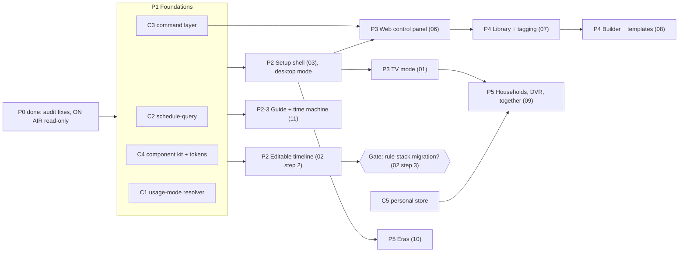

# RerunTV design set — roadmap and integration

Status: reference — the build order and contracts other docs follow (2026-09-12). Owner: Zach Hubbard.
Current implementation audit: [Remaining work, 2026-09-15](12-remaining-work-audit-2026-09-15.md).
Source references below use the reorganized repository paths. Phase tables describe
the original build order; consult the audit for current completion and validation.

Context: written after the 2026-09-12 usability audit (`af25fe4`) and the first
timeline step, SCHEDULE › ON AIR (`4eeff1b`).

This folder plans the large reworks together, so each one is designed against the
others instead of in isolation. Read this file first: it defines the shared contracts
every other doc depends on, the order to build in, and the conflicts that were
resolved on paper so they don't have to be resolved in code.

| # | Doc | One line |
|---|-----|----------|
| 01 | [Usage modes: Desktop and TV](01-usage-modes-desktop-and-tv.md) | Two first-class ways to use the whole app, not two skins |
| 02 | [Programming timeline](02-programming-timeline.md) | ON AIR → editable timeline → (maybe) one rule stack |
| 03 | [Setup shell and navigation](03-setup-shell-and-navigation.md) | Sidebar nav, list+detail lineup, one search, pinned footer |
| 04 | [Components and theme contract](04-components-and-theme-contract.md) | Shared controls, density tokens, contrast-checked themes |
| 05 | [Command layer and sync](05-command-layer-and-sync.md) | Every config write is a named command; the host owns config |
| 06 | [Web control panel and headless host](06-web-control-and-headless-host.md) | Edit from any browser; the box as a household server |
| 07 | [Media library and auto-tagging](07-media-library-and-tagging.md) | Catalogue once, reference from channels, tags without toil |
| 08 | [Channel builder and templates](08-channel-builder-and-templates.md) | Describe a channel or start from a template; preview, then apply |
| 09 | [Households, DVR and watching together](09-households-dvr-together.md) | Profiles, recordings, handoff, shared viewing |
| 10 | [Eras as a presentation layer](10-eras-presentation-layer.md) | Pick a year; the whole broadcast stack follows |
| 11 | [Guide and time machine](11-guide-and-time-machine.md) | Reachable special channels, day scrubber, calmer grid |

---

## 1. Invariants every design must keep

These already hold in the codebase. A design that needs to break one must say so
explicitly and get a decision, not quietly work around it.

1. **The schedule is a pure function of `(channel, time)`.** `resolveActiveSource`,
   `computeSourcePosition`, `resolveBreakAt` and friends take no hidden state; "now" is
   `viewNow()`. This is what makes the time machine, the LAN viewer, ON AIR and every
   future "preview" possible without a playback log. The one deliberate exception is live
   content lag (`S.contentLostMs`) during breaks, which never feeds back into scheduling.
2. **Config mutations are in place, invalidated by `S.configGeneration`.** Any cache
   derived from config keys on the generation. New write paths must bump it.
3. **Offline-first.** Local media, synthesized audio, user-authored text. Network features
   are opt-in named exceptions (Spotify Connect, LAN services, metadata plugins).
4. **Core is plugin-agnostic.** No core file assumes a plugin exists. Extension goes through
   `window.RCBPlugins` registries and the versioned `ctx` (currently `CTX_VERSION = 6`).
5. **One video element per client.** Every playback path goes through `#player`. Two
   simultaneous decodes (PIP, multiview) is an architectural fork, not a feature.
6. **Every client runs the same renderer bundle.** Electron, LAN browsers and the Android TV
   WebView differ only in how `window.api` is provided (`preload.js` vs
   `browser-api-shim.js`) and in viewport/input. No second UI codebase.
7. **LAN access is paired.** `main/lan/security.js`: per-service pairing code → session
   cookie/bearer. Viewers get a redacted config projection (`main/lan/viewer-projection.js`).

## 2. Shared contracts introduced by this set

These are the seams that make the reworks fit. Each is owned by one doc and consumed by
the rest; changing one means revisiting its consumers.

### C1. Usage mode (owner: 01)
`resolveUsageMode()` → `'desktop' | 'tv'`, stamped as `html[data-mode]`, resolved **per
client device**, never stored in `channels.json`. Everything with a layout or input model
reads it: the setup shell (03), components (04), the guide (11), plugins' settings panels.
A third, lighter **companion** surface (phone remote) stays what it is today — a separate
page — and is not a mode of the main app.

### C2. Schedule query API (owner: 02)
`renderer/js/core/schedule-query.js`: `querySchedule(ch, from, to, { breaks, offAir })`,
`explainAt(ch, t)`, `queryDay(ch, dayStart)` with the per-day `configGeneration` cache that
ON AIR already has. Consumers: ON AIR and the editable timeline (02), guide and scrubber
(11), web panel (06), DVR and reminders (09), builder/template previews (08). Pure; no DOM.
Extracted from `renderer/js/setup/onair.js`'s `computeDay` and Air Check's `inspect`.

### C3. Commands (owner: 05)
Every config write becomes a named, serializable command:
`dispatch({ type: 'channel.rename', channel: 7, name: 'Nick' })`. The command log is the undo
history, the sync protocol for remote editors (06), the apply step for templates and the
channel builder (08), and the audit trail. `saveConfigDebounced()` remains as the persistence
funnel underneath; commands call it, so `configGeneration` keeps working unchanged.

### C4. Components and tokens (owner: 04)
A small in-house component kit (plain ES modules, no bundler, no framework — consistent with
the renderer today) with **density** (`desktop` / `tv`) and **focus** built in. Themes
supply tokens only, validated for contrast at load. 03, 01, 06 and plugin settings panels
all build from it.

### C5. Two stores: broadcast config vs. personal state (owner: 09)
`channels.json` stays the **broadcast** config: channels, schedule, programming, box-wide
presentation. Anything that belongs to a *viewer* moves to a per-profile **personal store**:
favorites, history, reminders, air checks, recordings index, resume points, parental
restrictions per profile. Personal state never influences scheduling, never enters a config
backup, and is naturally excluded from the viewer projection. (Reminders and air checks live
in config today; 09 migrates them.)

### C6. Library item IDs (owner: 07)
Media gets stable IDs in a library index; channels keep their **materialized ordered file
list** (what the schedule math reads) plus the library references it came from. The schedule
never reads the library directly, so a library rescan can never silently re-anchor a channel
— re-materializing is an explicit command (C3) that shows its schedule impact first (C2).

### C7. Presentation overlay (owner: 10)
Effective presentation = box defaults ⊕ era overlay ⊕ channel identity ⊕ usage mode density,
resolved at read time like `effectiveThemeId()` does today. Eras never rewrite channel
config; switching back is lossless.

## 3. Build order

Foundations first, because nearly every visible rework rides on C2–C4.

| Phase | Contents | Exit criteria |
|------|----------|---------------|
| P0 ✅ | Audit fixes; ON AIR | shipped `af25fe4`, `4eeff1b` |
| P1 | C1 resolver + `data-mode`; C2 extracted, ON AIR/guide/Air Check moved onto it; C3 bus with commands for the ten most-used edits and undo on top; C4 primitives (Button, Field, SettingRow, Tabs, ListDetail, Dialog, FocusScope) | No visible regressions in the UI suite + theme sweep; undo/redo parity with today |
| P2 | Setup shell (03) in desktop mode; editable ON AIR (02 step 2); guide special-channel row + selected-row-in-view (11) | Lineup task times in doc 03 met; timeline edits round-trip through commands |
| P3 | TV mode (01) for TV screen + TV setup subset; web control panel (06) | A full evening on the Android TV client with no keyboard; remote edit from a laptop applies live |
| P4 | Library + tagging (07); builder + templates (08) | New channel from an empty folder in under 2 minutes with tags suggested |
| P5 | Personal store + profiles, DVR scheduling, handoff, watch together (09); eras (10); scrubber (11) if not earlier | Per-profile history/favorites; two clients share a party session |

Decision gate after P2: do we migrate programming to a single rule stack (02 step 3)?
Only if editable ON AIR usage shows the layer model is the remaining source of confusion.
08 and 07 are designed **not** to depend on that migration.

## 4. Conflicts resolved on paper

| Tension | Resolution |
|---------|------------|
| Web control panel (06) vs. in-app setup (03) — two editors | One editor. The web panel *is* the setup shell in desktop mode, served over LAN with a `control` session scope. No second UI. |
| TV mode (01) needs setup, but deep editing on a remote is miserable | TV mode ships a curated setup subset (lineup order/hide, favorites, picture, theme, parental, pairing, updates). Everything else offers "Edit on phone or computer" with a QR into the web panel (06). |
| Remote edits (06) vs. the out-of-band-write revert race (config saved by one path, clobbered by another's full-object save) | Host main process becomes the single config writer; renderers send commands (C3), receive the resulting generation. Removes the race class entirely instead of patching per handler. |
| Rule stack (02 step 3) would invalidate templates/builder (08) built on today's model | 08 emits commands against today's model; if the migration happens, commands are the compatibility layer (old command → new rules). |
| Library (07) rescans could shift schedules | C6: schedule reads materialized lists only; re-materialize is explicit and previewed. |
| Profiles (09) vs. deterministic schedule | Profiles only change *personal* state and *what is shown* (parental gating, hidden channels), never *what airs*. |
| Eras (10) vs. per-channel identity and user themes | C7 overlay order; channel identity still wins over era; "IGNORE ERA" per channel. |
| Watch together (09) vs. per-client time machine | A shared session pins a common `timeOffsetMs` + channel for its members; leaving restores the client's own. No new schedule state. |
| TV-mode density vs. themes tuned for desktop | Themes provide tokens; density scale lives in C4 and multiplies them. Theme packs may add `data-mode="tv"` refinements but must pass the same contrast check. |
| Headless host (06) vs. one-video-element, renderer-side playback | A headless host plays nothing. Clients (browser, Android TV, Electron) each do their own playback from the same pure schedule, exactly as LAN viewers already do. The host serves config, media, commands and pairing. |
| Plugins with custom settings panels vs. TV mode and the web panel | Declarative panels (`renderer/js/plugin/settings-schema.js`) render everywhere automatically. Custom `settings.js` panels are desktop-mode-only unless the plugin declares `modes: ['tv']` and passes focus checks. |

## 5. Cross-cutting requirements

- **Verification.** Each phase extends `tests/ui/` drivers (UI suite + theme sweep against the
  installed config, per `tests/ui/README.md`). Every new surface gets both a desktop and a TV
  pass once 01 lands.
- **Migrations.** Config reshapes register a numbered migration in `renderer/js/core/config-schema.js`
  (currently v1, empty). Versions are allocated in the order the migrations ship, not per doc:
  expected order is 07 library references (P4) → 09 personal-state extraction (P5) → 02 rule
  stack (only if the gate passes). Each migration must produce an empty 60-day
  `diffSchedules` per channel or abort for that channel. Personal-store and library files carry
  their own `schemaVersion`.
- **Plugin API.** Anything new plugins can call bumps `CTX_VERSION` and is documented in
  `PLUGIN_DEVELOPMENT.md` in the same change.
- **Performance budgets.** Setup tab switch < 100 ms; ON AIR week < 300 ms; guide open < 1
  frame of main-thread block for ≤ 30 channels; TV-mode focus move < 50 ms.
- **Accessibility.** Every control reachable by keyboard in desktop mode and by D-pad in TV
  mode; contrast ≥ 4.5:1 for body text in every theme (enforced by C4's theme check).

## 6. Open decisions

1. Framework question for C4: in-house kit (recommended here, for no-bundler/offline/plugin
   simplicity) vs. vendoring Lit. Revisit only if P1's kit exceeds ~1.5k lines.
2. Is the Android TV WebView the long-term TV client, or should Electron itself be the TV
   client on a mini-PC? 01 supports both; packaging priorities differ. Reference hardware is
   the owner's **Hisense 50QD6030G (Google TV) with its bundled remote**, which argues for the
   Android client as the primary TV path (01 §5.2a).
3. Does the web control panel (06) need internet-reachable access, or is LAN-only final?
   (LAN-only assumed; remote access would be a new network exception.)
4. Personal store location: alongside `channels.json` in portable `userData/`, or per OS
   user? (Alongside assumed, to keep portable installs portable.)
