# 01 — Usage modes: Desktop and TV

Status: proposed. Depends on: C4 components (04). Consumed by: 03, 06, 09, 10, 11, plugins.
Owns contract **C1** (see [00](00-roadmap-and-integration.md)).

## 1. Problem

RerunTV is used two very different ways, and today the app is one design stretched over both:

- **At a desk**: mouse, keyboard, a window among other windows, long setup sessions.
- **On a TV**: across the room, a remote with a handful of buttons, no pointer, no keyboard,
  often an Android TV box or a mini-PC in kiosk fullscreen.

The TV screen itself is reasonably remote-friendly, but everything around it assumes a desk:
- the setup screen needs a pointer;
- 21 of 26 hotkeys are letters no remote has;
- BACK leaves the Android client instead of closing the guide;
- one Hisense remote swallows its Settings button, so the Android client repurposes Play/Pause
  (`android-tv-client/.../MainActivity.kt`);
- D-pad Up/Down are hard-wired to channel change, which makes any on-screen menu that needs
  vertical focus movement fight the channel rocker.

`ui-scale` and `tv-client-viewport.js` fix *size*, not *interaction*.

## 2. Goals / non-goals

Goals
- Two first-class **usage modes** covering the *whole* app — watching, guide, menus, setup,
  first run, errors, dialogs, plugins — each with its own input model, density and feature scope.
- TV mode works with **any reasonable remote**: Android TV D-pads, Google/Chromecast remotes,
  Fire TV, Samsung (Tizen) and LG (webOS) remotes, pointer/air-mouse remotes, minimal
  5-key remotes, HDMI-CEC TV remotes passed through the box, Bluetooth/IR keyboards
  pretending to be remotes, and game controllers.
- Every feature reachable in TV mode with only **D-pad + OK + Back**. Extra buttons are
  shortcuts, never requirements.
- One codebase and one renderer bundle (invariant 6). Modes are presentation + input
  profiles, not forks.

Non-goals
- A touch-first phone mode for the main app (the companion page stays the phone surface).
- Full deep editing in TV mode (flow builder, bulk titles). TV mode hands those off (§7).
- Native Tizen/webOS apps in the first iteration (§9 keeps the door open).

## 3. What a mode is

| Aspect | Desktop | TV |
|---|---|---|
| Primary input | Pointer + keyboard | Remote (D-pad/OK/Back) — keyboard and pointer still work |
| Focus | Browser default + roving tabindex; rings only on keyboard use | Spatial focus always visible; exactly one focused element on screen |
| Density | Compact (14 px body, 32 px targets) | 10-foot (≥ 24 px body at 1080p, ≥ 64 px targets, 5% overscan-safe margins) |
| Navigation | Sidebar + tabs + list/detail (03) | Full-screen menus, one column of choices at a time, breadcrumb title |
| Setup scope | Everything | Curated subset + handoff (§7) |
| Window | Windowed, remembers bounds | Fullscreen/kiosk, hides cursor after 3 s idle, never shows OS chrome |
| Hover | Tooltips, hover states | None — anything informational is shown on focus |
| Text entry | Keyboard fields | Avoided; when needed, on-screen keyboard or "type on phone" (§7) |
| Launch | Opens last screen (setup if empty) | Opens straight to live TV on last channel; first run is a TV wizard |
| Idle | Nothing special | Screensaver/standby per power settings; wakes on any key |

A mode is resolved **per client** (C1). Two clients of the same box can be in different modes
at the same time (a laptop editing in desktop mode while the living-room box plays in TV mode).

## 4. Resolving the mode

```
explicit per-device choice  >  launch flag  >  client identity  >  heuristic suggestion
```

1. **Per-device choice** — stored client-side (Electron: `window-state.json` neighbour
   `client-prefs.json`; browsers/WebViews: `localStorage`), never in `channels.json`.
2. **Launch flag** — `--mode=tv` / `--kiosk` for Electron (mini-PC under a TV);
   `?mode=tv` for browser clients.
3. **Client identity** — Android TV WebView UA (`RerunTV-AndroidTV`, already detected by
   `tv-client-viewport.js`) → TV. Tizen/webOS browser UAs → TV.
4. **Heuristic suggestion** (never auto-switches silently): first input is an arrow/OK with no
   pointer movement in 10 s *and* fullscreen on a ≥ 40" display → toast "Switch to TV mode?".

API (renderer, `renderer/js/usage-mode.js`):

```js
resolveUsageMode(): 'desktop' | 'tv'
setUsageMode(mode, { remember = true })   // stamps html[data-mode], fires 'usage-mode-change'
onUsageModeChange(fn)
```

`html[data-mode="tv"]` is what CSS and components (04) key on. `ui-scale.js` stays: it answers
"how big is the canvas", mode answers "how is it used". In TV mode the density tokens are
defined against a 1920×1080 logical canvas, matching `tv-client-viewport.js`.

## 5. Input: from raw keys to actions

### 5.1 The core change
Today the Android client turns remote buttons into **fake keyboard letters** and `handleKey`
(`app.js`) switches on letters. That loses meaning (Up = channel up *and* focus up) and makes
every new remote a new keycode table in Kotlin.

Replace it with a two-stage pipeline shared by every client:

```mermaid
flowchart LR
  subgraph Sources
    K[Keyboard keydown]
    A[Android KeyEvent via bridge]
    T[Tizen / webOS keyCode]
    G[Gamepad API]
    M[mediaSession actions]
    R[Phone remote / companion command]
    C[HDMI-CEC via Android]
  end
  Sources --> N["normalize → RemoteKey<br/>(up, down, ok, back, chUp, digit7, red, playPause, …)"]
  N --> P["remote profile<br/>(learned overrides, long-press rules)"]
  P --> X["context router<br/>(watching / guide / menu / dialog / text field / plugin)"]
  X --> Act["Action<br/>(channel.next, focus.down, guide.open, menu.back, …)"]
```



- **RemoteKey** is a closed vocabulary of *physical* buttons (≈ 45 values): `up down left right
  ok back home menu info guide chUp chDown volUp volDown mute digit0..9 dot playPause play pause
  stop rewind fastForward prev next record red green yellow blue settings search exit tv
  captions audioTrack power` plus `longPress(<key>)`.
- **Actions** are what the app does: `channel.next`, `channel.prev`, `channel.last`,
  `channel.digit`, `guide.toggle`, `info.toggle`, `menu.open`, `nav.back`, `focus.up`…,
  `volume.up`, `timeMachine.toggle`, `timeMachine.shuttle(±)`, `scan.toggle`, `record.toggle`,
  `captions.toggle`, `setup.open`, `power.toggle`.
- **Context router**: the same key maps to different actions per context. `up` while watching
  → `channel.next`; `up` in the guide or any menu → `focus.up`; `up` in a text field → nothing
  (the field handles it). `chUp` is `channel.next` everywhere except where a list pages.
- Desktop keeps its letter shortcuts: the keyboard source in desktop mode also emits
  `letter(g)` etc., mapped to the same actions. Plugins' `registerInterrupt` hotkeys become
  action bindings with a letter *and* an optional RemoteKey.

The Android client stops synthesizing letters: it posts `{source:'android', keyCode, action,
repeatCount, longPress}` through its existing JS bridge; normalization happens in JS where it is
testable and shared. Kotlin keeps only what JS cannot do (see 5.4).

### 5.2 Remote profiles
Remotes differ in which buttons exist, which are swallowed by the OS, and what they send.

| Profile | Typical buttons delivered to the app | How TV mode covers the gaps |
|---|---|---|
| **Minimal** (Google TV/Chromecast, Fire TV basic, many Hisense/TCL) | D-pad, OK, Back, Home*, Play/Pause, Vol*/Mute* (*often system-only) | Long-press OK = **more actions** (TV menu on live TV); Back from live TV = menu/exit prompt; menu holds every action; on-screen number pad for tuning |
| **Full cable-style** (IR universal, CEC TV remotes, some Android boxes) | + digits, CH±, Guide, Info, Exit, colour keys, Last | Direct mapping; colour keys get context actions shown in on-screen hints |
| **Media** (Fire TV, Shield, Apple-style) | + Rewind/FF, Menu (≡) | RW/FF = time-machine shuttle; ≡ = TV menu |
| **Samsung Tizen** | D-pad, OK, Return (10009), colour keys (403–406), digits, CH±, media keys — most must be registered via `tizen.tvinputdevice.registerKey` | Tizen shim registers keys and normalizes codes |
| **LG webOS** | D-pad, OK, Back (461), colour keys (403–406), digits, CH±; **Magic Remote pointer** | webOS shim normalizes; pointer mode (§5.3) |
| **Pointer / air mouse** (LG Magic Remote, air mice, Wiimote-style) | Pointer moves + click, sometimes D-pad | Hover moves focus; click = OK; cursor auto-hides; switching back to D-pad keeps focus where the pointer left it |
| **Gamepad** (Shield controller, Xbox on Android TV/PC) | Stick/D-pad, A/B/X/Y, bumpers, triggers | A=OK, B=Back, X=Info, Y=Guide, LB/RB=CH−/CH+, LT/RT=shuttle, Start=TV menu, stick with repeat+deadzone |
| **Keyboard as remote** (Bluetooth mini keyboards) | Arrows, Enter, Esc, letters | Desktop letter shortcuts still work in TV mode |
| **Phone remote / companion** | Anything (virtual) | Already sends commands; becomes a RemoteKey/Action source |

The profile is **auto-built from what arrives**: every RemoteKey seen is recorded for that client
(`client-prefs.json`/`localStorage`). On-screen hints only advertise buttons this remote has
actually delivered — "● GUIDE" appears only after a Guide key has been pressed once; until then
the hint says "OK hold: MENU". This avoids the current problem of hints naming letters a remote
doesn't have.

**Learn mode** (TV settings › Remote › Customize): "Press the button you want for GUIDE" writes
an override for keys the auto-mapping gets wrong (vendor keycodes, colour-key conventions).
Overrides are per client, exportable, and have a "reset to default".

### 5.2a Reference hardware: Hisense 50QD6030G + its bundled remote

The primary TV this is designed and verified against is the owner's **Hisense 50QD6030G**, using
the remote that ships with it, running the sideloaded `android-tv-client` on the TV's Google TV
OS. Every TV-mode milestone is signed off on this set first; the other profiles above are
supported by the same pipeline but verified second.

What is already known about this remote, from building the Android client against it
(`android-tv-client/.../MainActivity.kt`, `docs/retro_cable_box_lan_viewer.md`):

| Button | Delivered to the app? | Current use | TV-mode design use |
|---|---|---|---|
| D-pad ▲▼◀▶ | yes (`KEYCODE_DPAD_*`) | arrows; ▲▼ also change channel | `up/down/left/right` → context actions (§5.1) |
| OK (center) | yes | `Enter` | `ok`; **long-press OK = more actions** (the TV menu on live TV) |
| Back | yes | not intercepted (exits app) | `back` owned by app, exit prompt at top level (§5.3) |
| Home | no (system) | — | never intercepted |
| CH ▲▼ rocker | yes (`KEYCODE_CHANNEL_UP/DOWN`) | channel ± | `chUp/chDown` → channel ± everywhere; pages lists in menus |
| VOL ▲▼, Mute | typically handled by the TV itself | — | if delivered, app volume; otherwise TV volume is fine — no dependency |
| Play/Pause | yes (`KEYCODE_MEDIA_PLAY_PAUSE`) | opens native overlay/TV menu | `playPause` → TV menu (kept as the known-good path) |
| Settings ⚙ | **no — intercepted by the TV's system settings** | — | not relied on; ignored if ever delivered |
| "123" | **unknown** (digits vs. system number overlay) | not relied on | if it yields `digit*`, direct tuning; otherwise on-screen number pad |
| Streaming-app shortcut buttons | no (OS-reserved) | — | never intercepted |
| Voice/Assistant, Input, Power | assumed system-reserved | — | not relied on; `visibilitychange` covers leaving/returning |

Consequences for the design:
- **Everything must work with D-pad + OK + Back + CH rocker + Play/Pause**, since those are
  the buttons this remote is confirmed to deliver. That is the "Minimal" profile, which is why
  §5.3's rules are written around it.
- **Play/Pause always opens the TV menu; long-press OK opens it from live TV** (on a focused item it opens that item's actions, which include "TV menu"); the menu is the home of Guide, Info,
  Time Machine, Mute, Scan, Record, Captions, Setup and every other letter-bound shortcut.
- **CH rocker and D-pad ▲▼ stop being identical.** On live TV both change channel; in the
  guide and menus only D-pad moves focus, while the CH rocker pages a screenful — the first
  real benefit of the action pipeline on this remote.
- **Guide access without a Guide button:** from live TV, D-pad ◀ opens the guide (▶ opens the
  channel banner/actions), advertised in the hint bar. Both are otherwise unused while watching.

**Step B0 — capture the real button map before Phase B.** Add a *Remote test* screen to the
Android client (reachable from its native overlay) and to TV settings › Remote. It lists
every event as it arrives — `keyCode`, `scanCode`, `repeatCount`, down/up timing, and whether
the page ever saw it — so each "unknown"/"assumed" row above is filled from the actual
50QD6030G remote instead of guessed. Save the result as
`android-tv-client/remote-profiles/hisense-50qd6030g.json`, which becomes the first built-in
profile (§5.2) and the fixture for the input-matrix test (§11).

### 5.3 Rules that make every remote usable
- **D-pad + OK + Back reach everything.** Long-press OK is a contextual "more actions": on
  live TV it opens the TV menu; on a focused item (guide program, list row, channel) it opens that
  item's action menu, whose last entry is always "TV menu". The TV menu contains every action,
  including those normally on dedicated keys. Where Play/Pause is delivered it opens the TV menu
  from anywhere.
- **Back is owned by the app** (reverses today's Android choice): Back closes the top overlay,
  then leaves a menu level, then from live TV shows a small "Exit RerunTV? / Keep watching"
  prompt. Leaving the app is therefore always possible, just not accidental.
- **Home is never intercepted** (OS reserves it); **Settings/gear** is treated as `menu` when
  delivered and ignored when not (the Hisense case).
- **Tuning without digits:** OK on live TV opens the channel banner; from there Left/Right
  steps channels without tuning, OK tunes. A number pad in the TV menu covers direct entry.
- **Key repeat**: channel actions debounce (today's `CHANNEL_DEBOUNCE_MS` moves to JS and
  applies to every source); focus actions accelerate after 400 ms hold; volume repeats at 8 Hz.
- **Long-press** is detected in JS from keydown/keyup (or Android `repeatCount`), threshold
  500 ms, so it works identically across sources. Long-press never *replaces* the short action
  for a key that has one without an on-screen hint saying so.
- **No double-meaning traps**: contexts are explicit; a stuck focus (nothing focusable) falls
  back to the context's default action set, never to "keys do nothing".
- **Pointer and D-pad coexist**: pointer movement shows the cursor and makes hover focus; the
  first D-pad press hides the cursor and continues from the last focused element.

### 5.4 What stays native
- Android: capturing keys before the WebView, long-press/`repeatCount`, CEC events that only
  arrive natively, keep-screen-on, launching on boot, the pairing/host screen.
- Tizen/webOS (if packaged, §9): `registerKey` calls and app lifecycle (`visibilitychange` →
  power/standby semantics).
- Electron (mini-PC kiosk): `globalShortcut` is **not** used; kiosk launch + normal keydown is
  enough. Media keys arrive via `mediaSession` (already wired in `playback-broadcast-fx.js`).

## 6. TV-mode surfaces

### 6.1 Watching
Unchanged broadcast look. Differences: hint bar shows remote-appropriate hints (§5.2); the
channel banner (OK) becomes the hub — Left/Right browse channels, Down opens "Now / Next /
Info / Record / Reminder" actions for the shown program.

### 6.2 Guide
Focus-driven (already mostly true). Special channels are ordinary focusable rows in numeric order (11). The
selected row stays in view. Colour keys: red = time jump −24 h, green = +24 h, yellow =
filter/genre, blue = reminders (advertised only when present). Search uses on-screen keyboard
or "type on phone".

### 6.3 TV menu
Today's `tv-menu.js` grid becomes the root of a **hierarchical TV menu**: Watch actions ·
Channels · Picture & Sound · Guide & Theme · Recordings · Profiles (09) · Setup · Remote ·
System. One column of large choices, breadcrumb title, Back goes up a level.

### 6.4 Setup in TV mode (curated)
Included — tasks that make sense with a remote:
- **Channels**: reorder (move mode: OK picks up, Up/Down moves, OK drops), show/hide,
  favourite, rename via on-screen keyboard, set rating, lock.
- **Picture & sound**: CRT on/off and sliders (Left/Right adjusts), aspect, picture mode,
  volumes, captions default.
- **Guide & theme**: theme gallery with live preview, clock format, guide slots.
- **Parental lock**: PIN entry with the number pad or D-pad wheel.
- **Profiles** (09), **Remote** (customize/learn), **Pairing** (QR for phone remote and web
  panel), **Updates**, **Power** (standby, sleep, keep-awake).

Handed off (§7): folders/library, blocks and timeline editing, flows, ad pool, tag taxonomy,
plugin management, backups restore, diagnostics.

### 6.5 First run on a TV
A TV wizard: Welcome → "Add channels on your phone or computer" QR (06) *or* "Use a folder on
this device" (Android: SAF picker; Electron: native dialog, which a remote can drive) →
update policy → remote check ("Press OK… Press Back… Hold OK…") which seeds the remote profile
→ live TV.

### 6.6 Dialogs, errors, plugins
Every dialog is a FocusScope (04) with a default-focused safe action; destructive actions never
default. Plugin channel UIs get `ctx.input.onAction` (actions, not raw keys — replacing today's
`onKey` for new plugins; `onKey` keeps working in desktop mode and receives synthesized letters
in TV mode for backward compatibility).

## 7. Handoff: TV → phone/computer

A consistent pattern for anything too heavy for a remote:

- The TV shows "Edit on your phone or computer" with a **QR** and short URL to the web control
  panel (06), deep-linked to the exact task (`/control/channels/7/schedule`).
- The QR carries a one-time pairing token for a `control`-scope session (06), so scanning it
  is also authentication.
- The TV shows live progress ("Editing on Zach's Pixel…") and reflects applied commands
  immediately (C3), so the person on the couch sees results without leaving the TV.
- Text entry anywhere in TV mode offers "Type on phone" using the same channel.

## 8. Desktop mode

Desktop mode is the setup shell of doc 03 plus today's TV screen with keyboard shortcuts. Two
additions from this doc:
- **Remote-in-desktop**: if a remote-style source is detected in desktop mode (gamepad, CEC,
  a mini keyboard sending only arrows), it still works through the same action pipeline.
- **Preview TV mode** (Picture & Guide › Interface): renders the TV layout inside the window at
  1920×1080 logical so layouts and plugin panels can be checked without a TV.

## 9. Client platforms

| Client | Mode default | Input sources | Status |
|---|---|---|---|
| Electron on desktop | desktop | keyboard, pointer, mediaSession, gamepad | exists |
| Electron kiosk on mini-PC (`--mode=tv --kiosk`) | tv | keyboard/IR-as-keyboard, CEC (via libcec helper, optional), gamepad, pointer | new launch flag |
| Android TV WebView client | tv | Android KeyEvent bridge, CEC via Android, gamepad | exists; bridge changes (§5.1) |
| LAN browser on a smart TV (Tizen/webOS built-in browser) | tv | normalized keyCodes; limited (browser often steals Back/colour keys) | best-effort |
| Packaged Tizen/webOS hosted web app | tv | full key registration | later; the same bundle wrapped, no fork |
| LAN browser on laptop/tablet | desktop | keyboard, pointer, touch | exists |

## 10. Implementation plan

**Phase A — plumbing (P1).**
- `usage-mode.js` + `html[data-mode]`.
- `remote-input.js`: normalize → profile → context router → actions.
- `actions.js`: a registry mapping action ids to today's functions (`changeChannel`,
  `openGuideGrid`, …).
- `handleKey` becomes a thin keyboard source; behaviour in desktop mode must be byte-for-byte
  unchanged, which the existing UI suite checks.

**Phase B — Android bridge (P1–P2).**
- Kotlin posts raw key events.
- Back stops exiting and gets the exit prompt.
- Long-press OK becomes "more actions" (TV menu on live TV); Play/Pause keeps opening the TV menu.
- Remove the Kotlin keycode table.

**Phase C — TV surfaces (P3).**
- Hierarchical TV menu, banner hub, guide colour keys, dialog FocusScopes.
- TV density tokens (04).
- Remote hints driven by the observed profile.

**Phase D — TV setup subset + handoff (P3).** Built on 03's pages with TV-density components;
QR handoff once 06 exists.

**Phase E — platforms (P4+).** Kiosk flag + optional CEC helper; Tizen/webOS shims; gamepad.

## 11. Testing

- **Input matrix harness**: a CDP driver that replays recorded event streams per profile
  (Minimal, Full, Tizen, webOS, Gamepad, Pointer) and asserts the resulting actions per context.
- **Reachability test**: from live TV, using only `up/down/left/right/ok/back`, a breadth-first
  crawl must reach every action in the registry and every TV setup page. Run in CI-style scratch.
- **Focus invariants** per TV screen: exactly one focused element, focused element visible and
  inside overscan margins, focus ring contrast ≥ 3:1 in every theme.
- **Real hardware checklist** before each release, in order: **Hisense 50QD6030G with its
  bundled remote (reference, must pass)**, then Fire TV remote, Shield controller, an LG Magic
  Remote (browser), one IR universal remote via CEC.
- The recorded `hisense-50qd6030g.json` event streams (§5.2a, step B0) are replayed by the
  input-matrix harness on every change to `remote-input.js`.

## 12. Risks and open questions

- **Vendor keycodes vary** even within Android; learn mode is the safety valve, and the
  auto-profile avoids advertising buttons that don't work.
- **Back ownership** changes existing Android behaviour; ship with the exit prompt and a
  "Back exits immediately" option for users who prefer it.
- **Smart-TV built-in browsers** may never deliver Back or colour keys; they get a documented
  "best-effort" tier, and the Android client remains the recommended TV path.
- **Plugin `onKey` compatibility**: synthesizing letters in TV mode keeps old plugins working
  but can reintroduce the double-meaning problem inside plugin channels; new ctx input API
  should be adopted by first-party channel plugins in Phase C.
- Open: should TV mode allow *any* folder/library editing on-device for single-device users
  with no phone? (Proposed: yes, via the native picker only; everything else via handoff.)
