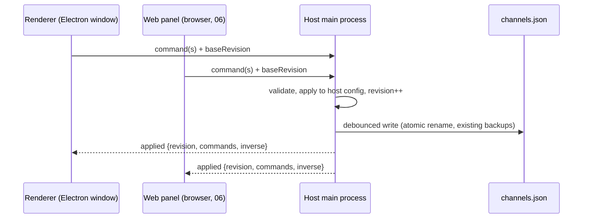

# 05 — Command layer and sync

Status: proposed (P1). Owns contract **C3**. Consumed by: 02, 03, 06, 08, 09.

## 1. Problem

Config is edited by mutating `S.config` in place from dozens of handlers, then calling
`saveConfigDebounced()`, which writes the **whole** object to disk through `config:save`.
This works for a single window, and `S.configGeneration` keeps caches honest. It breaks down
for what's planned:

- **Out-of-band writes revert silently.** A main-process IPC handler that writes
  `channels.json` itself gets clobbered by the renderer's next full save. This happened with
  plugin capability approvals; each such handler is patched by hand.
- **Undo is whole-config JSON snapshots** (up to `MAX_UNDO_ENTRIES`). That's fine locally,
  but it can't be shared, described ("Undo rename channel 7"), or merged with another
  editor's changes.
- **Remote editing (06) and TV handoff (01 §7) need another client to change config** while
  the TV watches, without last-writer-wins on the whole file.
- **Templates and the channel builder (08) need to describe a change**, preview it (02's
  `diffSchedules`), and then apply it atomically.

## 2. Design

### 2.1 Commands
```js
dispatch({ type: 'channel.rename', channel: 7, name: 'Nick' })
dispatch.batch('Apply template "Saturday Morning"', [cmd1, cmd2, …])
```
A command is a plain JSON object:
- `type` from a registry;
- a payload validated by that type's schema;
- optional `meta` (who, when, client id).

Each type defines:

```js
registerCommand('channel.rename', {
  validate(payload, config) { … },         // throws a user-facing error
  apply(config, payload) { … return inverse; }, // mutates in place (keeps invariant 2), returns inverse command(s)
  describe(payload, config) { return `Rename CH 7 to "Nick"`; },
  touches: (payload) => ['channels', payload.channel],   // for sync conflicts and cache hints
})
```

- `apply` mutates in place and bumps `configGeneration`, so every existing cache keeps working.
- `apply` returns the **inverse**, which is what undo stores. No more whole-config snapshots
  for command-driven edits.
- Unknown/legacy edits (code not yet migrated) go through a catch-all `config.patch` command
  carrying a JSON-merge-patch computed from before/after, so undo and sync still work during
  migration.

### 2.2 One writer: the host

- The **host main process owns config**. `main-config.js` gains an in-memory copy and applies
  commands with the same registry (the registry is plain JS shared by main and renderer, like
  `config-diff.js` already is).
- Renderers apply commands **optimistically** locally, send them with their `baseRevision`,
  and reconcile on the host's `applied` event. Rejected commands roll back locally using the
  inverse and toast the error.
- `config:save` of a whole object remains only for import/restore, and is itself a command
  (`config.replace`) so every client is notified.
- Main-process handlers that edit config (capability approval, plugin enable, updater state)
  dispatch commands instead of load-modify-save. This removes the revert-race class entirely.

### 2.3 Revisions and conflicts
- Host keeps a monotonically increasing `revision` and a ring buffer of the last N applied
  commands.
- A client sending commands with an old `baseRevision` gets them applied if their `touches`
  don't intersect commands applied since; otherwise the host re-runs `validate` against current
  config and either applies (safe, e.g. renaming a different field) or rejects with a conflict
  the UI shows ("Channel 7 was changed on another device — reload that panel").
- No CRDTs. A single household with occasional concurrent edits doesn't need them; touch-set
  conflict detection is enough.

### 2.4 Transport
- Electron renderer ↔ host: IPC (`config:command`, `config:applied` events).
- LAN clients (06, LAN viewer, Android TV client): an authenticated **SSE** stream
  `GET /api/events` for `applied` + presence, `POST /api/commands` for writes. Uses the existing
  pairing/session model (`main-lan-security.js`) with a new `control` scope; `view` sessions
  receive `applied` events filtered through the viewer projection and can't POST.
- The LAN viewer's 10 s `/api/config` poll is replaced by the event stream (poll stays as a
  fallback when SSE drops).

### 2.5 Undo/redo
- Per client, a stack of `{ label, commands, inverses }`. Undo dispatches the inverses as a new
  batch, so undo is itself synced and conflict-checked.
- Labels come from `describe`, so the status bar (03) reads "Undo: Rename CH 7".
- Debounced bursts (slider drags, typing) coalesce: consecutive commands of the same type and
  target within 800 ms merge into one undo entry (replacing today's debounce-snapshot trick).
- `lastChannel`-style writes stay `skipUndo` (a command flag).

### 2.6 Personal state (C5)
Commands for the personal store (09) use the same bus with `scope: 'personal:<profileId>'`,
written to that profile's file, never to `channels.json`, never broadcast to other profiles.

## 3. Command catalogue (first wave)

| Area | Commands |
|---|---|
| Channels | `channel.add`, `channel.remove`, `channel.rename`, `channel.renumber`, `channel.reorder`, `channel.setOptions` (rating, favorite, hidden, color…), `channel.setIdentity`, `channel.setBroadcastHours` |
| Content | `channel.addFolder`, `channel.removeFolder`, `channel.setOrder` (natural/seeded/reverse/manual), `file.setTitle`, `file.setTags`, `file.setDescription`, `file.setBreakpoints` |
| Schedule | `block.create`, `block.update`, `block.setHours`, `block.addDay`, `block.overrideDay`, `block.setPriority`, `block.remove` |
| Programming | `preset.*`, `flow.*`, `pool.addEntries`, `pool.updateEntry`, `pool.removeEntries` |
| Box settings | `settings.set` (path allow-listed per section, e.g. `display.crt.*`, `guide.slots`) |
| Plugins | `plugin.setEnabled`, `plugin.approveCapabilities`, `plugin.setSettings` |
| Whole config | `config.replace` (import/restore), `config.patch` (legacy catch-all) |

Plugins register their own commands through `ctx.commands.register` (namespaced `plugin:<id>.*`),
which is how plugin settings stay undoable and remote-editable.

## 4. Migration

**Status:** steps 1–2 are built.
- `renderer/js/commands.js` is pure: a registry, `diffJson`/`applyPatch` with inverses,
  identity-aware array splices, and `config.patch`, `settings.set`, `channel.set`,
  `channel.rename`, `channel.remove`, `channel.insert`.
- History and `dispatch()` live in `state.js`, next to `saveConfigDebounced`.
- Converted call sites: every plain per-channel option (18 fields plus the CC/SAP/stereo
  defaults and volume), rename (coalesced), remove, and the CRT toggle and sliders (each drag
  coalesced).
- Undo/redo tooltips and the command palette show the step's label.
- Tests: `tests/commands.test.js`, which includes a 300-case randomized diff round-trip.

Verified live against the installed lineup (scratch `test/verify-commands.mjs`):
- every path undoes, and config was byte-identical after a full edit-then-undo sequence;
- settling a burst on the 1.2 MB config costs about 1 ms;
- the 34-check UI suite passes.

Deviations from the plan above:
- The in-place label for an unsettled burst reads "Recent edit", because settling just to
  label it would split a burst on the button refresh timer.
- A skipUndo write that is still unsaved when a real edit starts joins that edit's step. This
  matches the old snapshot history.

Steps 3–5 (host ownership, SSE, burning down `config.patch` callers) are not started.

1. Registry + local bus in the renderer; `config.patch` catch-all wraps
   `saveConfigDebounced()` (diff since last generation), so undo moves to inverses with no
   caller changes.
2. Move the ten most-used edits to real commands (rename, renumber, reorder, rating, favorite,
   add/remove folder, block edits, CRT settings).
3. Host ownership: main applies commands, renderer becomes optimistic client; convert the
   out-of-band IPC writers.
4. SSE transport + `control` scope (unblocks 06).
5. Burn down `config.patch` usage per `setup-*.js` file; the audit driver reports remaining
   callers.

## 5. Acceptance criteria

- Undo/redo parity: the existing UI suite's undo checks pass unchanged after step 1.
- Two clients editing different channels simultaneously: both apply, no reverts, both see
  each other's changes within 1 s.
- Capability approval or plugin enable done while another setup edit is pending survives
  (regression test for the historical revert bug).
- Applying a 50-command template batch is one undo step and one disk write.

## 6. Risks

- **Double application** (optimistic + applied echo): commands carry client-generated ids;
  clients ignore echoes of their own ids after reconciling.
- **Schema drift between main and renderer**: the registry file is shared and versioned with
  `CONFIG_SCHEMA_VERSION`; a client on an older app build is refused `control` scope.
- **Large imports**: `config.replace` bypasses per-field validation but still runs
  `applyConfigDefaults` + migrations host-side before broadcast.
