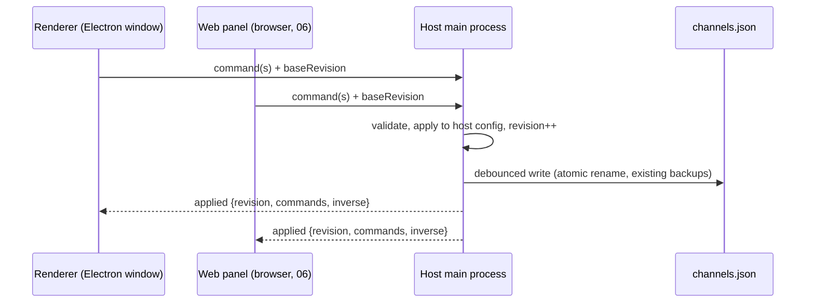

# 05 — Command layer and sync

Status: **built** (see §4). The renderer and paired LAN control clients both send named commands to the host, which merges or refuses them per client, and plugins register their own. Owns contract **C3**. Consumed by: 02, 03, 06, 08, 09.

## 1. Problem

Config is edited by mutating `S.config` in place from dozens of handlers, then calling
`saveConfigDebounced()`, which writes the **whole** object to disk through `config:save`.
This works for a single window, and `S.configGeneration` keeps caches honest. It breaks down
for what's planned:

- **Out-of-band writes revert silently.** A main-process IPC handler that writes
  `channels.json` itself gets clobbered by the renderer's next full save. This happened with
  plugin capability approvals; each such handler is patched by hand.
- **Undo is whole-config JSON snapshots** (up to `MAX_UNDO_ENTRIES`). That's fine locally,
  but it can't be shared, described ("Undo rename channel 7"), or merged with another
  editor's changes.
- **Remote editing (06) and TV handoff (01 §7) need another client to change config** while
  the TV watches, without last-writer-wins on the whole file.
- **Templates and the channel builder (08) need to describe a change**, preview it (02's
  `diffSchedules`), and then apply it atomically.

## 2. Design

### 2.1 Commands
```js
dispatch({ type: 'channel.rename', channel: 7, name: 'Nick' })
dispatch.batch('Apply template "Saturday Morning"', [cmd1, cmd2, …])
```
A command is a plain JSON object:
- `type` from a registry;
- a payload validated by that type's schema;
- optional `meta` (who, when, client id).

Each type defines:

```js
registerCommand('channel.rename', {
  validate(payload, config) { … },         // throws a user-facing error
  apply(config, payload) { … return inverse; }, // mutates in place (keeps invariant 2), returns inverse command(s)
  describe(payload, config) { return `Rename CH 7 to "Nick"`; },
  touches: (payload) => ['channels', payload.channel],   // for sync conflicts and cache hints
})
```

- `apply` mutates in place and bumps `configGeneration`, so every existing cache keeps working.
- `apply` returns the **inverse**, which is what undo stores. No more whole-config snapshots
  for command-driven edits.
- Unknown/legacy edits (code not yet migrated) go through a catch-all `config.patch` command
  carrying a JSON-merge-patch computed from before/after, so undo and sync still work during
  migration.

### 2.2 One writer: the host

- The **host main process owns config**. `main/config/config.js` gains an in-memory copy and applies
  commands with the same registry (the registry is plain JS shared by main and renderer, like
  `main/config/diff.js` already is).
- Renderers apply commands **optimistically** locally, send them with their `baseRevision`,
  and reconcile on the host's `applied` event. Rejected commands roll back locally using the
  inverse and toast the error.
- `config:save` of a whole object remains only for import/restore, and is itself a command
  (`config.replace`) so every client is notified.
- Main-process handlers that edit config (capability approval, plugin enable, updater state)
  dispatch commands instead of load-modify-save. This removes the revert-race class entirely.

### 2.3 Revisions and conflicts
- Host keeps a monotonically increasing `revision` and a ring buffer of the last N applied
  commands.
- A client sending commands with an old `baseRevision` gets them applied if their `touches`
  don't intersect commands applied since; otherwise the host re-runs `validate` against current
  config and either applies (safe, e.g. renaming a different field) or rejects with a conflict
  the UI shows ("Channel 7 was changed on another device — reload that panel").
- No CRDTs. A single household with occasional concurrent edits doesn't need them; touch-set
  conflict detection is enough.

### 2.4 Transport
- Electron renderer ↔ host: IPC (`config:command`, `config:snapshot`, `config:applied` events).
  **Built.**
- LAN clients: `POST /api/commands` on the viewer server, control scope only, plus
  `GET /api/control/config` and `GET /api/control/state`. **Built.** Uses the existing
  pairing/session model (`main/lan/security.js`) with a `control` scope; `view` sessions are
  refused with 403 and cannot POST.
- **No SSE.** Change notices ride the existing cursor-based `/api/remote-events` bus, which
  step 4 already extended with `config:changed`; the LAN viewer's poll is a 60 s fallback.
  A second push transport was not built, and doc 06's SSE prose is stale — see its transport
  note.

### 2.5 Undo/redo
- Per client, a stack of `{ label, commands, inverses }`. Undo dispatches the inverses as a new
  batch, so undo is itself synced and conflict-checked.
- Labels come from `describe`, so the status bar (03) reads "Undo: Rename CH 7".
- Debounced bursts (slider drags, typing) coalesce: consecutive commands of the same type and
  target within 800 ms merge into one undo entry (replacing today's debounce-snapshot trick).
- `lastChannel`-style writes stay `skipUndo` (a command flag).

### 2.6 Personal state (C5)
Commands for the personal store (09) use the same bus with `scope: 'personal:<profileId>'`,
written to that profile's file, never to `channels.json`, never broadcast to other profiles.

## 3. Command catalogue (first wave)

| Area | Commands |
|---|---|
| Channels | `channel.add`, `channel.remove`, `channel.rename`, `channel.renumber`, `channel.reorder`, `channel.setOptions` (rating, favorite, hidden, color…), `channel.setIdentity`, `channel.setBroadcastHours` |
| Content | `channel.addFolder`, `channel.removeFolder`, `channel.setOrder` (natural/seeded/reverse/manual), `file.setTitle`, `file.setTags`, `file.setDescription`, `file.setBreakpoints` |
| Schedule | `block.create`, `block.update`, `block.setHours`, `block.addDay`, `block.overrideDay`, `block.setPriority`, `block.remove` |
| Programming | `preset.*`, `flow.*`, `pool.addEntries`, `pool.updateEntry`, `pool.removeEntries` |
| Box settings | `settings.set` (path allow-listed per section, e.g. `display.crt.*`, `guide.slots`) |
| Plugins | `plugin.setEnabled`, `plugin.approveCapabilities`, `plugin.setSettings` |
| Whole config | `config.replace` (import/restore), `config.patch` (legacy catch-all) |

Plugins register their own commands through `ctx.commands.register` (namespaced `plugin:<id>.*`),
which is how plugin settings stay undoable and remote-editable. **Built** (ctx v7) — see §4.

Two things make a plugin command safe, and both are structural rather than checked:
the type is always built by core from the id passed in, so a plugin cannot register outside
its own namespace or shadow a core command; and the plugin's `apply`/`validate`/`describe`
receive **that plugin's settings object and nothing else**, so there is no route from a plugin
command to the channel lineup, to box settings, or to another plugin's settings. Its touch
tokens are prefixed with `plugins/<id>/settings/` for the same reason.

The host has no plugin renderers and so no registry entry for these types. A command may
declare `toHost(config, cmd)`, which states what to send instead; a plugin command sends the
settings it produced as a plain `plugin.setSettings`. Undo history keeps the precise command,
so the step still reads as what the plugin called it.

## 4. Migration

**Status:** steps 1–2 are built.
- `renderer/js/core/commands.js` is pure: a registry, `diffJson`/`applyPatch` with inverses,
  identity-aware array splices, and `config.patch`, `settings.set`, `channel.set`,
  `channel.rename`, `channel.remove`, `channel.insert`.
- History and `dispatch()` live in `renderer/js/core/state.js`, next to `saveConfigDebounced`.
- Converted call sites: every plain per-channel option (18 fields plus the CC/SAP/stereo
  defaults and volume), rename (coalesced), remove, and the CRT toggle and sliders (each drag
  coalesced).
- Undo/redo tooltips and the command palette show the step's label.
- Tests: `tests/commands.test.js`, which includes a 300-case randomized diff round-trip.

Verified live against the installed lineup (scratch `tests/ui/verify-commands.mjs`):
- every path undoes, and config was byte-identical after a full edit-then-undo sequence;
- settling a burst on the 1.2 MB config costs about 1 ms;
- the 34-check UI suite passes.

Deviations from the plan above:
- The in-place label for an unsettled burst reads "Recent edit", because settling just to
  label it would split a burst on the button refresh timer.
- A skipUndo write that is still unsaved when a real edit starts joins that edit's step. This
  matches the old snapshot history.

**Step 3 is built, in a narrower form than §2.2.**
- `main/config/host.js` gives the host a revision and a 200-entry ring of the commands it has
  applied.
- Host-side edits are now commands applied there: `plugin.setApproval`, `plugin.setEnabled`,
  `plugin.forget`, and the headless Companion settings patch as a set-only `config.patch`. Each
  is broadcast as `config:applied` and also returned to the caller.
- The renderer applies them to `S.config` and its undo baseline (`applyHostUpdate`), never as
  undo steps, and reports the newest one it has applied with every save.
- `config:save` replays onto the incoming config any host commands the renderer hadn't seen,
  and never replays across a backup restore.
- This ends the revert race without hand-mirroring: the four mirrors in `renderer/js/setup/plugins.js` are
  gone, and the six direct `window.api.saveConfig` calls now go through `saveConfigNow()`.

The renderer still sends its whole config on save rather than commands only. That, and the
host holding config in memory rather than re-reading the file, move with step 5's burn-down of
`config.patch` callers.

Replaying is safe only because host commands set values rather than append. Any new
host-applied command must keep that property; the tests check it.

Verification:
- `tests/config-host.test.js` (8), including the revert race end to end with the real renderer
  `renderer/js/core/state.js`.
- Live (scratch `tests/ui/verify-config-host.mjs`, 8/8): a deliberately stale save through real IPC
  was repaired.
- The packaged exe loads `renderer/js/core/commands.js` from `app.asar` and applies host commands.

**Step 4 is built for viewer read sync, and it deliberately does not add SSE.**

Why no new stream:
- The viewer server already has an authenticated, cursor-based event channel. Every paired
  viewer long-polls `/api/remote-events` every 250 ms, and it already carries
  `companion:configChanged`.
- A second push transport would have duplicated it.

What is built:
- **Announcing.** When `channels.json` is written (renderer save, host command, backup restore),
  `createChangeAnnouncer` in `main/config/host.js` fingerprints the config minus the host's own
  watching state (`lastChannel`, `muted`, `volume`, `pictureMode`, `aspectMode`,
  `display.hintBar`). If the fingerprint differs from the last one, it publishes
  `config:changed` on that channel.
- **Viewers.** Browsers and the Android TV client refetch their redacted projection on that
  event. Their 10 s poll is now a 60 s fallback.
- **No config on the bus.** Only a notice travels on the event bus, never config, so redaction
  stays in one place (`/api/config`).
- **Measured.** A real setup edit reached a paired session 669 ms later, most of it the 600 ms
  save debounce. Surfing and volume changes on the host announced nothing (scratch
  `tests/ui/verify-viewer-config-push.mjs`).

Not in this step:
- **Streaming commands to viewers.** Viewers see a redacted projection where paths are opaque
  ids, so host commands can't be replayed on them as-is.
- **`POST /api/commands` with a `control` scope.** That write path belongs with the web control
  panel (doc 06 phase 1), which is its only consumer.

**Step 5 is built: the renderer has no untyped config writes left.** `saveConfigDebounced()`
callers in `renderer/js` went from 297 to 0, and `tests/config-writes.test.js` keeps it at 0.
`node scripts/audit-config-writes.js` reports what's left.

How edits are recorded now:
- **`dispatch(command)`** for edits a command can make itself: a setting, a channel field, an
  added or removed item.
- **`commitInPlace(command)`** for editors that already changed the live objects and keep
  references to them: a rule row, a flow's cadence, a block's trigger, a days row.
  - The command states the value as it now stands and is applied only to the undo baseline.
    That gives its inverse, and S.config keeps the same objects, so an editor never ends up
    holding a detached copy.
  - A command that changes nothing in the baseline is dropped.
  - `commitItemEdit(collection, [item, before])` is the list-item form. It works out which
    top-level fields changed from a copy taken before the edit.
- **`commitConfigPatch(label)`** for transforms that rewrite many parts of config at once. It
  records one labelled `config.patch`. There are 11 call sites: applying or saving a curation
  profile, the scheduled curation run, renaming or removing a tag everywhere, a library resync,
  a channel package import, a folder relink, Companion settings and a dropped batch of pool
  files.
- **Watching state** from the TV screen (last channel, mute, volume, picture and aspect mode,
  CRT, hint bar, air checks, expired reminders) goes through `commitInPlace` with
  `skipUndo`: saved, never an undo step.

New commands:
- `channel.setFields`, `channel.renumber`, `channel.swapNumbers`.
- `file.set`.
- `item.set` / `item.insert` / `item.remove` on id-addressed lists: `pool`, `presets`,
  `flows`, and `blocks`, which is scoped to a channel.
- `plugin.setSettings`.
- `settings.set`'s allow-list now covers every box-level section the renderer writes.

Behaviour that changed for users:
- Removing a block, a pool entry, a preset, a flow, a curation profile or several channels at
  once can now be undone, and the confirmation dialogs say so.
- Several edits that never saved on their own now save immediately: adding a preset block, a
  day override, a calendar block, or moving a day override.

Verified live against the installed lineup through the real listeners (scratch
`tests/ui/verify-step5-commands.mjs`, `-lists.mjs`, `-rest.mjs`, 30 checks):
- bulk-tagging the 205-entry pool and the 1329-file channel is one step each;
- the cadence and block objects the panels hold survive their edits;
- after undoing every step, config was byte-identical;
- no history fallbacks were logged.
The 34-check UI suite, `verify-config-host` and `verify-viewer-config-push` all pass.

Found while testing: `renderer/js/plugin/host.js` and `renderer/js/setup/plugin-settings.js` pass `saveConfigDebounced`
by reference into plugin contexts. A write-count audit must not drop that import.

**Step 6 is built: the renderer posts commands, and the host merges or refuses them.**

Before this, `renderer/js/core/state.js` sent `window.api.saveConfig(S.config, hostRevision)`
on every debounced write. It now applies each edit optimistically and posts the commands that
made it, on the same 600 ms debounce, so the write rate is unchanged.

- **Touch sets.** Every command definition in `renderer/js/core/commands.js` declares
  `touches(cmd)`, and `commandTouches` / `batchTouches` / `touchesConflict` are the merge
  policy. Tokens are slash-separated and match by ancestry, so `channels` covers
  `channels/7/name` but `channels/7` does not cover `channels/70`. Deliberately coarse where
  an edit changes addressing rather than a value: `channel.renumber`, `channel.swapNumbers`,
  `channel.insert` and `channel.remove` all touch `channels`, because a command another
  client built against the old numbering may no longer mean what it said. `config.patch`
  touches `*` and so conflicts with everything — it is the whole-config transform case
  (a curation run, a tag rename, an import), which cannot be merged with a concurrent edit.
  A command type with no `touches()` is treated as `*`, so a new or plugin-supplied command
  is safe before anyone has thought about it.
- **Five outcomes** from `main/config/host.js`'s `applyCommands`, for a client-origin batch:
  *duplicate* (same batch id: answered with the first result, never applied again — client
  commands are not all idempotent), *conflict* (touch sets intersect what another client did
  since `baseRevision`), *compatible* (they do not: applied, because two people editing
  different channels is the ordinary case), *stale-reset* (built before a backup restore),
  and *stale-window* (older than the 200-entry ring can prove safe). A host-origin batch
  still throws on a bad command, which is what the main-process callers expect; a
  client-origin one gets a typed refusal object, because it has to cross an IPC or HTTP
  boundary and be shown to somebody.
- **Ring entries record their origin.** Replaying onto a whole-config save stays restricted
  to HOST-origin commands, which set values and survive being applied twice. A client
  command may splice an array, so a save that would bury one is refused instead.
- **Echo suppression.** `applyHostUpdate` takes only the revision from an update carrying
  this client's own id. Without it an `item.insert` would insert twice (§6).
- **Reconciliation is a full resync, not a rollback.** On any refusal the client rebuilds
  from `config:snapshot` — config and revision read together, so no update is applied twice
  or skipped across the gap two round trips would open — and drops its undo history, which
  described a config that no longer exists. Touch-set detection does not promise the
  intervening commands commute with the refused ones, so unwinding around them would be
  guesswork. `renderer/js/setup/keyboard.js` redraws the open setup screen and says what
  happened in the status bar.
- **Whole-config saves remain** for the edits no command describes: an import, a restore, the
  DONE flush, first-run onboarding, a setting that recreates the window. They are also how a
  session first agrees with the host: this renderer runs `applyConfigDefaults()` over the
  config it loads and the host does not, so until those defaults have reached disk once, a
  command naming a defaulted section would not find it there. The first write of a session is
  therefore a whole-config save and every write after it is commands.

Transport: `config:command` (IPC) and `config:snapshot`, exposed as `window.api`'s
`applyConfigCommands` / `getConfigSnapshot`. The LAN command endpoint belongs with doc 06.

Verification:
- `tests/config-host.test.js` (20), covering each of the five outcomes plus the whole-config
  refusal and the pre-existing replay behaviour.
- `tests/commands.test.js` (28), covering what actually reaches the host: a dispatch, a burst,
  a `skipUndo` write, undo's inverses, a remote update not being echoed back, and this
  client's own echo advancing the revision without applying twice.
- Live, through the real preload and `channels.json` (`tests/ui/verify-command-transport.mjs`,
  17/17): duplicate delivery, a conflicting stale client, two clients on different channels,
  renderer resync after refusal, and a host command applied through the real module path.
- `verify-step5-commands.mjs` still reports config byte-identical after undoing every step.

**Step 7 is built: LAN control clients use the same protocol.**

`POST /api/commands` on the viewer server hands the batch to the same
`configHost.applyCommands()` the Electron renderer reaches over IPC, so there is one writer
and one merge policy, not two. The route forces `origin: 'client'`, so a LAN batch can never
arrive claiming to be a trusted host edit and skip conflict checking. A refusal answers 409
with the same typed body the renderer gets, because a refusal is a normal answer the client
acts on, not a server error. Bodies are capped at 256 KB; a template or an import is a
separate upload endpoint, not this one.

Access is `main/lan/security.js`'s new scope model (doc 06 §4): one pairing code per scope,
sessions stored as `token -> { expiresAt, scope }`, and scope carried by the token rather than
by anything the client sends. Entering the control code on a device that already holds a view
session mints a *new* session — the old token keeps view scope, so a token only ever meant to
watch can never become one that can write. A sessions file written before scopes existed reads
back as view-only.

Verification:
- `tests/lan-control.test.js` (9): the two codes, scope-per-token, a view session refused on
  every control route, the no-widening rule, duplicate and conflict over HTTP, an `origin:
  'host'` claim being ignored, credentials stripped from the control config, malformed and
  oversized bodies, and the legacy sessions-file migration.
- Live (`tests/ui/verify-lan-control.mjs`, 18/18, 0 renderer runtime errors): a real LAN
  control session editing the real lineup, with the Electron window seeing the change **23 ms**
  later — §5's "within 1 s" criterion. The control config carried 3493 real host paths and 0
  opaque refs; the viewer projection over the same config carried 0 real paths and 3886 opaque
  refs, so the redaction boundary is where it should be.

**Step 8 is built: `ctx.commands` (ctx v7).** `registerPluginCommand` /
`unregisterPluginCommands` / `pluginCommandType` in `renderer/js/core/commands.js`,
`pluginCommands` in `renderer/js/plugin/host.js`, documented in `PLUGIN_DEVELOPMENT.md`
under "Undoable edits with `ctx.commands`". `hostCommandsFor` is the outbound translation
described in §3. A plugin's `settings.js` may still use `ctx.saveConfigDebounced`; it now has
a better option rather than only that one.

Verification: `tests/plugin-settings-fields.test.js` (6) covers the namespace, the
settings-only scope, the inverse mapping, the touch prefix and the `toHost` translation, plus
the registration refusals. Live through the real plugin host
(`tests/ui/verify-command-transport.mjs`, 23/23): a registered command carried its own undo
label, wrote only its plugin's settings, left the lineup and theme untouched, reached
`channels.json` as `plugin.setSettings`, and undid precisely.

1. Registry + local bus in the renderer; `config.patch` catch-all wraps
   `saveConfigDebounced()` (diff since last generation), so undo moves to inverses with no
   caller changes.
2. Move the ten most-used edits to real commands (rename, renumber, reorder, rating, favorite,
   add/remove folder, block edits, CRT settings).
3. Host ownership: main applies commands, renderer becomes optimistic client; convert the
   out-of-band IPC writers.
4. SSE transport + `control` scope (unblocks 06).
5. Burn down `config.patch` usage per `setup-*.js` file; the audit driver reports remaining
   callers.

## 5. Acceptance criteria

- Undo/redo parity: the existing UI suite's undo checks pass unchanged after step 1.
- Two clients editing different channels simultaneously: both apply, no reverts, both see
  each other's changes within 1 s. **Met:** `tests/config-host.test.js` and
  `verify-command-transport.mjs` cover both applying; `verify-lan-control.mjs` measured a LAN
  edit reaching the Electron window in 23 ms.
- Capability approval or plugin enable done while another setup edit is pending survives
  (regression test for the historical revert bug).
- Applying a 50-command template batch is one undo step and one disk write.

## 6. Risks

- **Double application** (optimistic + applied echo): commands carry client-generated ids;
  clients ignore echoes of their own ids after reconciling.
- **Schema drift between main and renderer**: the registry file is shared and versioned with
  `CONFIG_SCHEMA_VERSION`; a client on an older app build is refused `control` scope. The host
  loads that shared file by path (`COMMANDS_MODULE_PATH` in `main/config/config.js`), lazily,
  at the first host command — so a wrong path surfaces as a silently failed plugin approval
  rather than a boot error. It broke exactly that way in the directory reorganization;
  `tests/config-host.test.js` now resolves and imports the path the application really uses.
- **Large imports**: `config.replace` bypasses per-field validation but still runs
  `applyConfigDefaults` + migrations host-side before broadcast.
