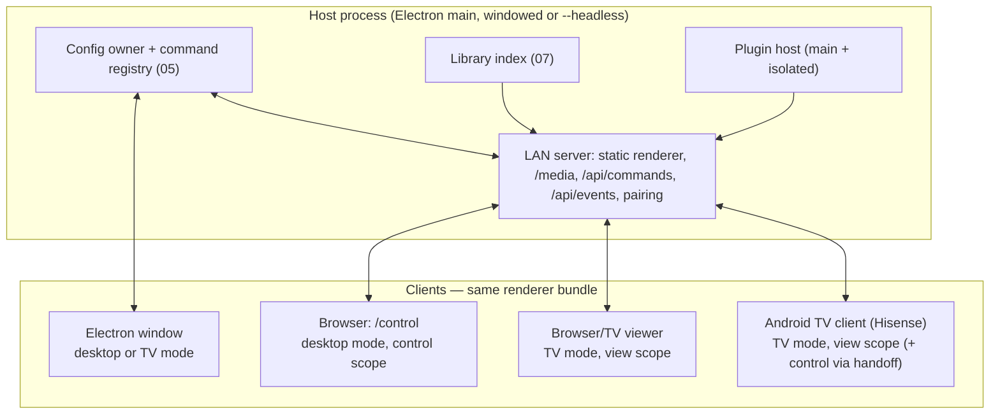

# 06 — Web control panel and headless host

Status: **phases 1–3 built** — §4 access, the command endpoint, the `/control` route, the writable shim and host folder browsing. Asset upload, deep links/QR handoff, "Preview on…" and presence (phases 4–5) are not. Depends on: C3 commands (05), setup shell (03), C1 modes (01).
Consumed by: 01 (TV handoff), 08, 09.

Transport note (2026-09-16): doc 05 reused `/api/remote-events` instead of SSE,
and the control work extends that same cursor-based bus rather than adding a
second push transport. **SSE below is not being built**; read every mention of
it as "the event bus". Doc 05 step 6 has landed, so the command protocol this
document depends on (revisions, touch-set conflicts, duplicate batch ids,
authoritative resync) exists — over IPC. What remains here is the LAN side of
it: a `control` scope, `POST /api/commands`, the `/control` route and a
writable shim.

## 1. Problem

- Editing happens only in the Electron window on the box. On a TV setup (the Hisense
  50QD6030G via the Android client) there is no good place to edit: the remote can't, and the
  host PC may be in another room.
- LAN viewers and the Android TV client get a read-only config projection. Doc 05
  already added config-change notices over the existing 250 ms event poll, with
  a 60 s config fallback; writable control sessions remain to be built.
  `renderer/js/browser-api-shim.js` answers `applyConfigCommands` with a
  `read-only` refusal rather than a silent no-op, so a client that cannot write
  finds out instead of appearing to save.
- `--server` / `--headless` launch modes already exist (`main/main.js`, `tests/headless-server.test.js`):
  the host can run with no window, print pairing URLs and serve viewers. It can't be
  *administered* without the window.

## 2. Goals

- **Edit from any browser on the LAN** — laptop, tablet, phone — with the same UI as the desktop
  setup shell (03), not a second admin app.
- **The box as a household server**: a headless host (mini-PC, always-on desktop, later a
  NAS/Docker build) serving config, media, pairing, commands and events; every TV/browser is a
  client that plays for itself.
- Deep links and QR handoff from TV mode (01 §7).

Non-goals: internet access (LAN-only; remote access would be a new named network exception),
multi-household tenancy, server-side video transcoding streams (clients keep direct media URLs;
the existing ffmpeg transcode stays host-side and file-based).

## 3. Architecture

- The web panel **is the renderer bundle** served at `/control`, booted with
  `window.__controlClient = true`: setup shell only (no auto-tune, no playback unless the user
  presses Watch/Preview, in which case it behaves like a viewer). **Built**, with one
  correction to the plan: the marker is set by `browser-api-shim.js` from
  `window.location.pathname`, not injected into the page. index.html's Content-Security-Policy
  has no `'unsafe-inline'` and the file deliberately contains no inline `<script>`, so an
  injected marker would simply be blocked. `/control` therefore serves the file byte-identical
  to `/`, and `/control/` redirects to `/control` so its relative asset URLs still resolve.
- The marker is a convenience, never a permission. Opening `/control` with a `view` session
  gets a 403 from the route, and even if the bundle were reached another way every write still
  has to pass `requireScope('control')` on the host.
- `browser-api-shim.js` grows a **control implementation** of the write APIs: every
  config-mutating `window.api` call becomes a command POST (05). **Built.** Whether this
  device may write is the host's answer, from a one-time `/api/control/state` probe, not
  something the page decides about itself. There is deliberately no whole-config write over
  the LAN — it would be last-writer-wins across a household — so `saveConfig` answers
  `unsupported` and `state.js` sends commands instead. File pickers become host-side folder
  browsers (see §5), which is phase 3.
- A control client does **not** run the viewer's config poll: that refetches and replaces
  `S.config` wholesale, which would throw away an edit in progress. It stays in step through
  the command protocol — `config:applied` for another editor's commands, and an authoritative
  resync when the host refuses one of its own.
- Viewers and TV clients keep `view` scope; handoff grants a short-lived `control` session to
  the scanning device only.

## 4. Access and security

Extends `main/lan/security.js`; no new auth concepts.

| Scope | Gets | Obtained by |
|---|---|---|
| `view` | redacted config projection, media, events (filtered) | pairing code (today) |
| `control` | commands (`POST /api/commands`), `GET /api/control/config` and `/api/control/state`; the full setup UI once §8 phase 1 lands | a **separate** control pairing code, shown on the loopback server page today and on the host window/TV setup screen with the control surface; a one-time QR token from TV handoff is future work |
| `admin` (host window only) | plugin install/uninstall, capability approval, updates, network services | not grantable remotely in v1 — no `admin` scope is issued by `createLanAccess` at all |

Built (2026-09-16): scopes live on the session token, not on the request.
`createLanAccess(service, { scopes: ['view', 'control'] })` mints one pairing code
per scope and stores sessions as `token -> { expiresAt, scope }`; `scopeOf(req)`
and `requireScope(req, res, 'control')` are the gate. Presenting the control
code on a device that already holds a view session issues a **new** session
rather than widening the old one, so a watch-only token stays watch-only. A
sessions file from before scopes existed reads back as view-only.

- Control sessions are remembered per device (existing `sessionsFile` mechanism), revocable
  from System › Network services, listed with device name + last seen.
- Every command records `meta.client`, shown in undo labels ("Rename CH 7 — from iPad").
- Rate limits and body size caps reuse `main/util/http.js` conventions; `/api/commands` bodies
  are capped at 256 KB (large imports go through a separate upload endpoint with a size limit).
  **Built.**
- Secrets never leave the host: plugin settings with credential-shaped keys stay write-only
  from remote clients (shown as "••• set"). **Built** for reads —
  `GET /api/control/config` returns real host paths, which an editor needs, run through
  `sanitizeViewerConfig` so every credential-shaped key is gone. `/api/config` is unchanged and
  still returns the fully redacted viewer projection with opaque `viewer:` refs.

## 5. Things that are local-only today

| Feature | Remote behaviour |
|---|---|
| Add folder (`selectFolder` native dialog) | **Host folder browser** — **built**. `main/lan/control-browse.js` + `GET /api/control/browse`, with `renderer/js/control-picker.js` as the dialog. Roots are the directories this config already refers to (a control client can already see those paths in `/api/control/config`, so listing inside them discloses nothing new) plus `network.controlBrowseRoots`, which the person at the host sets — that key is in the remote-denied list, so a remote editor cannot widen its own reach. Containment is `isPathContained` on a resolved, normalized path, and "outside the roots" and "does not exist" give the same answer so the host's disks cannot be mapped by probing. `GET /api/control/scan` re-checks the folder rather than trusting that it came from a listing it served. Library roots (07) will become a source of roots when they exist. |
| Image/video pickers (logo, overlays) | **Picking from the roots is built** (`selectImage`/`selectAudio`/`selectVideo` open the same browser, filtered by extension). Upload to the host's `userData/assets/` is **not built** — the picker covers the case where the file is already on the host, which is the ordinary one for a media library; upload is for a file that only exists on the tablet. |
| Export config / support bundle | Download from host |
| Import config / channel package | Upload, then a `config.replace` or package-merge command with preview |
| Plugin install from zip | Host window only (`admin`) — **enforced**: `selectExecutable`/`selectCss` keep refusing even for a control session, and `pluginsInstallFromZip` is host-only in the contract. |
| Capability approval | Host window only (`admin`) — **enforced** at the command layer, not only in the UI: `plugin.setApproval`, `plugin.setEnabled` and `plugin.forget` are refused for any batch that arrived over HTTP (`main/config/host.js`'s `REMOTE_DENIED_COMMANDS`), as are `settings.set` writes under `network`, `updates` or `pinLock`, and any `config.patch`. The check keys on `remote`, set by the route itself rather than by whoever wires it up, so the Electron window keeps all of them. |
| Preview on TV | "Preview on…" picks a connected TV client; host sends a `client.tune` event to it (the Hisense TV tunes while you watch from the couch) |

## 6. Headless host

`--headless` today prints URLs; this doc makes it a complete product mode:

- **Startup**: no window; tray icon on desktop OSes with "Open control panel", "Show pairing
  code", "Quit". On a server build, a tiny loopback status page (exists) plus the control
  pairing code in the log.
- **Plugins**: main-process plugin halves run as usual; renderer-only plugins (channel UIs)
  run in each client as they already do for viewers. Plugins that need a host renderer
  (none currently essential) are marked `requiresHostWindow` and disabled headless with a
  visible reason.
- **Background work**: library sync, scheduled recordings (09), transcodes, backups continue.
- **Packaging (later)**: an Electron-free Node build of the host is plausible because main
  modules are already mostly Electron-free (LAN security, viewer server, projection). Tracked
  as a later option; not required for v1 since Electron `--headless` works.

## 7. Presence and live collaboration

Over the event bus (not SSE — see the transport note):
- `presence`: which clients are connected, their mode, what they're watching (viewers opt in
  per device), what page a control client has open. **Not built** (phase 5). What exists today
  is `config:applied` on the bus, filtered per request so only a `control` session receives it
  — a `view` session must not, because those events carry real config values.
- The status bar (03) shows "Also editing: Zach's laptop"; a list/detail item edited elsewhere
  shows a subtle badge.
- TV handoff progress (01 §7) is a presence state on the TV client.

## 8. Implementation phases

1. ~~`/control` route + control scope + command POST~~ — **control scope and command POST
   are built** (05 step 7); the `/control` route itself is the next piece. No SSE; the
   existing `/api/remote-events` bus carries change notices.
2. ~~Shim control implementation for the ten first-wave commands~~ — **built, and for every
   command, not ten**: the panel runs the same `state.js` as the Electron window, so whatever
   the setup shell can dispatch there it can dispatch here. What remains read-only remotely is
   what needs the host's filesystem (folder pickers, import/restore, plugin installs).
3. ~~Host folder browser~~ **built**; asset upload and "channel creation fully remote" end to end still to prove.
4. TV handoff deep links + QR tokens; "Preview on…".
5. Presence UI; revoke/manage sessions; headless tray.
6. Burn down remaining read-only pages as their edits become commands.

## 9. Acceptance criteria

- From a phone that scanned the Hisense TV's handoff QR, add a folder channel and see it
  appear in the TV guide within 2 s, without touching the host PC.
- Kill the host window (`--headless` relaunch) mid-session: control clients reconnect and
  continue without re-pairing.
- A `view` session cannot POST commands or read unredacted config (tested).
- LAN viewer poll traffic replaced by SSE; config propagation < 1 s.

## 10. Risks

- Exposing folder browsing over LAN — mitigated by roots allow-list, control scope, host-only
  approval of new roots.
- Two UIs drifting — mitigated by construction (same bundle, same pages).
- Client/host version skew after an update — host refuses `control` to mismatched bundle
  versions and asks the client to reload.
