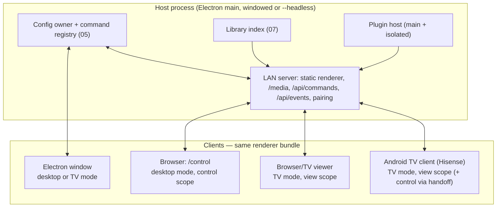

# 06 — Web control panel and headless host

Status: proposed (P3). Depends on: C3 commands + SSE (05), setup shell (03), C1 modes (01).
Consumed by: 01 (TV handoff), 08, 09.

Transport note (2026-09-15): doc 05 reused `/api/remote-events` instead of SSE.
SSE below remains a proposed transport, not a completed prerequisite; choose one
transport for the control work rather than duplicating existing notifications.

## 1. Problem

- Editing happens only in the Electron window on the box. On a TV setup (the Hisense
  50QD6030G via the Android client) there is no good place to edit: the remote can't, and the
  host PC may be in another room.
- LAN viewers and the Android TV client get a read-only config projection. Doc 05
  already added config-change notices over the existing 250 ms event poll, with
  a 60 s config fallback; writable control sessions remain to be built.
- `--server` / `--headless` launch modes already exist (`main/main.js`, `tests/headless-server.test.js`):
  the host can run with no window, print pairing URLs and serve viewers. It can't be
  *administered* without the window.

## 2. Goals

- **Edit from any browser on the LAN** — laptop, tablet, phone — with the same UI as the desktop
  setup shell (03), not a second admin app.
- **The box as a household server**: a headless host (mini-PC, always-on desktop, later a
  NAS/Docker build) serving config, media, pairing, commands and events; every TV/browser is a
  client that plays for itself.
- Deep links and QR handoff from TV mode (01 §7).

Non-goals: internet access (LAN-only; remote access would be a new named network exception),
multi-household tenancy, server-side video transcoding streams (clients keep direct media URLs;
the existing ffmpeg transcode stays host-side and file-based).

## 3. Architecture

- The web panel **is the renderer bundle** served at `/control`, booted with
  `window.__controlClient = true`: setup shell only (no auto-tune, no playback unless the user
  presses Watch/Preview, in which case it behaves like a viewer).
- `browser-api-shim.js` grows a **control implementation** of the write APIs: every
  config-mutating `window.api` call becomes a command POST (05). File pickers become
  host-side folder browsers (see §5).
- Viewers and TV clients keep `view` scope; handoff grants a short-lived `control` session to
  the scanning device only.

## 4. Access and security

Extends `main/lan/security.js`; no new auth concepts.

| Scope | Gets | Obtained by |
|---|---|---|
| `view` | redacted config projection, media, events (filtered) | pairing code (today) |
| `control` | full setup UI, commands, folder browsing, plugin settings | a **separate** control pairing code shown only on the host window/TV setup screen, or a one-time QR token from TV handoff |
| `admin` (host window only) | plugin install/uninstall, capability approval, updates, network services | not grantable remotely in v1 |

- Control sessions are remembered per device (existing `sessionsFile` mechanism), revocable
  from System › Network services, listed with device name + last seen.
- Every command records `meta.client`, shown in undo labels ("Rename CH 7 — from iPad").
- Rate limits and body size caps reuse `main/util/http.js` conventions; `/api/commands` bodies
  capped (e.g. 256 KB; large imports go through a separate upload endpoint with a size limit).
- Secrets never leave the host: plugin settings with credential-shaped keys stay write-only
  from remote clients (shown as "••• set").

## 5. Things that are local-only today

| Feature | Remote behaviour |
|---|---|
| Add folder (`selectFolder` native dialog) | **Host folder browser**: a paged directory listing API limited to configured library roots (07) plus drives the host admin explicitly allows; path-safety rules from `main/util/path-safety.js` |
| Image/video pickers (logo, overlays) | Upload to the host's `userData/assets/` (size/type limited) or pick from library roots |
| Export config / support bundle | Download from host |
| Import config / channel package | Upload, then a `config.replace` or package-merge command with preview |
| Plugin install from zip | Host window only (`admin`) |
| Capability approval | Host window only (`admin`) |
| Preview on TV | "Preview on…" picks a connected TV client; host sends a `client.tune` event to it (the Hisense TV tunes while you watch from the couch) |

## 6. Headless host

`--headless` today prints URLs; this doc makes it a complete product mode:

- **Startup**: no window; tray icon on desktop OSes with "Open control panel", "Show pairing
  code", "Quit". On a server build, a tiny loopback status page (exists) plus the control
  pairing code in the log.
- **Plugins**: main-process plugin halves run as usual; renderer-only plugins (channel UIs)
  run in each client as they already do for viewers. Plugins that need a host renderer
  (none currently essential) are marked `requiresHostWindow` and disabled headless with a
  visible reason.
- **Background work**: library sync, scheduled recordings (09), transcodes, backups continue.
- **Packaging (later)**: an Electron-free Node build of the host is plausible because main
  modules are already mostly Electron-free (LAN security, viewer server, projection). Tracked
  as a later option; not required for v1 since Electron `--headless` works.

## 7. Presence and live collaboration

Over the SSE stream:
- `presence`: which clients are connected, their mode, what they're watching (viewers opt in
  per device), what page a control client has open.
- The status bar (03) shows "Also editing: Zach's laptop"; a list/detail item edited elsewhere
  shows a subtle badge.
- TV handoff progress (01 §7) is a presence state on the TV client.

## 8. Implementation phases

1. `/control` route + control scope + command POST/SSE (depends on 05 step 4).
2. Shim control implementation for the ten first-wave commands; everything else read-only
   remotely with a banner "Edit on the host for now".
3. Host folder browser + asset upload; channel creation fully remote.
4. TV handoff deep links + QR tokens; "Preview on…".
5. Presence UI; revoke/manage sessions; headless tray.
6. Burn down remaining read-only pages as their edits become commands.

## 9. Acceptance criteria

- From a phone that scanned the Hisense TV's handoff QR, add a folder channel and see it
  appear in the TV guide within 2 s, without touching the host PC.
- Kill the host window (`--headless` relaunch) mid-session: control clients reconnect and
  continue without re-pairing.
- A `view` session cannot POST commands or read unredacted config (tested).
- LAN viewer poll traffic replaced by SSE; config propagation < 1 s.

## 10. Risks

- Exposing folder browsing over LAN — mitigated by roots allow-list, control scope, host-only
  approval of new roots.
- Two UIs drifting — mitigated by construction (same bundle, same pages).
- Client/host version skew after an update — host refuses `control` to mismatched bundle
  versions and asks the client to reload.
