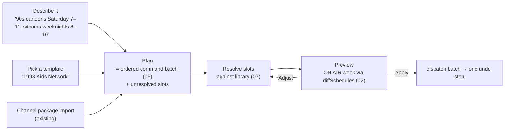

# 08 — Channel builder and templates

Status: built (P4, 2026-09-16). Depends on: C2 schedule queries (02), C3 batches (05), C6 queries (07).
Consumed by: 01 (TV first run), 06, 10.

## Implementation status

The shared, DOM-free engine is `renderer/js/library/channel-builder.js`. It validates v1
templates, contains the six built-ins, parses the published offline phrase grammar, resolves
slots through the library query engine, reports playable counts/skipped durations, and compiles
a fully materialized channel with ordinary schedule blocks. The Channels `+ ADD CHANNEL` flow
offers Empty, From template and Describe it. Its preview blocks apply until every required slot
is filled; applying dispatches one `channel.insert`, so the entire channel is one undo step and
uses the existing LAN command transport unchanged.

An edited channel can be exported with **SAVE AS TEMPLATE…**. The exported JSON contains
inferred tag queries and block structure but no paths. **IMPORT CHANNEL** recognizes both the
existing channel-package format and template JSON, routing templates through the same resolver
and preview. Because `/control` runs the same renderer bundle, these flows work in the desktop
window and paired web control panel without another implementation.

The deterministic grammar intentionally accepts comma-separated clauses in the form
`<content> <days> <start> to <end>`, including `weeknights`, `weekdays`, `Saturdays`, `Sundays`,
`daily`, 12/24-hour times, genre terms, decades, and series/title text. The prompt publishes an
example rather than implying unrestricted natural-language understanding.

## 1. Problem

Recreating a real network block — Saturday morning cartoons, 25 Days of Christmas, a Friday
movie premiere, TGIF — takes blocks, calendar days, presets, flows, pool entries, a logo and a
theme, built across a dozen screens. The block presets menu (`+ ADD BLOCK ▾`) and auto-curate
profiles help with pieces. There is no way to get a whole channel from an intent, and no way
to share one.

## 2. Two front doors, one engine



Everything becomes a **plan**: a list of commands with *slots* that refer to content by intent
(`{ slot: 'cartoons', query: { genre: 'cartoon', era: '1990s' } }`) rather than by path.
Resolving binds slots to library queries or folders; preview renders the result; apply dispatches
one batch. Channel package import (`renderer/js/library/channel-package.js`) becomes a plan source too, getting the
same preview.

## 3. Templates

### 3.1 Format
```jsonc
{
  "templateVersion": 1,
  "id": "kids-network-1998",
  "name": "1998 Kids Network",
  "era": "1998",                             // optional link to 10
  "slots": {
    "cartoons": { "label": "Classic cartoons", "match": { "genre": ["cartoon"], "era": ["1980s", "1990s"] }, "min": 20 },
    "live":     { "label": "Live-action kids shows", "match": { "genre": ["kids"], "kind": "episode" } },
    "bumpers":  { "label": "Network bumpers", "match": { "kind": ["bumper"] }, "optional": true }
  },
  "channel": { "name": "Kids Network", "identity": { "theme": "analog-90s" }, "rating": "TV-Y7" },
  "programming": [
    { "block": { "days": [6], "hours": [7, 11], "play": { "slot": "cartoons" } } },
    { "block": { "days": [1,2,3,4,5], "hours": [15, 18], "play": { "slot": "live" } } }
  ],
  "breaks": { "cadence": { "everyMinutes": 11 }, "pool": { "slot": "bumpers" } }
}
```
Templates contain **no paths and no media**. Slots are matched against the user's library (07).
They compile to today's commands (blocks, presets, pool tags), and would compile to rules if 02
step 3 ever happens.

### 3.2 Sources
- **Built-in** first-party templates (Saturday Morning, Christmas Countdown, Movie Night,
  Primetime Sitcoms, Late Night, Marathon).
- **Export from a channel** ("Save as template"): the exporter replaces concrete folders
  with slots inferred from tags/facets, and asks the user to name each slot.
- **Plugin-provided** template registration remains an extension point rather than part of the
  v1 core contract; template files give plugins and people the same offline interchange now.
- **Files**: `.rerun-template.json` import/export. No online gallery in v1 (offline
  invariant); a later opt-in gallery plugin could add one.

### 3.3 Slot resolution UX
For each slot: best matching library query (item count, sample titles, total hours), with
alternatives (pick folder, pick series, loosen match). Unfilled required slots block apply;
optional slots can be skipped. "Too little content for a daily block" warnings come from the
plan's hours ÷ available duration.

## 4. Describe-a-channel

- **Parser, local-first**: a deterministic grammar for scheduling language covers the common
  cases offline — days ("weeknights", "Saturday mornings"), times ("7–11", "prime time" =
  20–23), date ranges ("December 1st to 25th"), content phrases matched to taxonomy terms and
  series names from the library ("cartoons", "90s sitcoms", "The Office"), break language
  ("ads every 10 minutes", "no commercials during movies").
- Output is a plan with slots. V1 previews the parsed rows and returns to the description field
  for adjustment; inline editable chips are presentation follow-up, not a plan-format change.
- **Optional LLM assist** as a plugin (explicit network exception, off by default) that turns
  free text into the same plan JSON, validated by the same schema. The core never depends on it.

## 5. Where it appears

- **Channels › Add** (03): Empty channel · From folder · From template · Describe it.
- **TV first run** (01 §6.5): "Start with a template" picks from built-ins using the device
  library or the handoff flow.
- **Web panel** (06): identical.
- **ON AIR** (02): "Save this week's structure as a template".

## 6. Acceptance criteria

- "90s cartoons Saturdays 7 am to 11 am, sitcoms weeknights 8 pm to 10 pm" builds a previewable
  channel offline in < 10 s on the installed library (once 07 tags exist).
- Applying a template is one undo step; undo leaves an empty `diffSchedules` against before.
- Round trip: save channel as template → apply on a copy of the library → same block
  structure.

## 7. Risks

- Tag coverage limits everything here; 07's tagging queue ships first and templates show
  "needs tagged content" guidance when slots match too little.
- Grammar scope creep: keep a published phrase list in the manual; everything else via chips.

## 8. Verification

`tests/channel-builder.test.js` covers the acceptance phrase, required-slot blocking, detached
library items, materialized block compilation, path-free export and schema refusal. The tracked
suite reports 323/323 passing after this implementation.

**2026-09-17:** the plugin template registry (§3.2, "remains an extension point rather than part
of the v1 core contract") is now built — `registerTemplate`/`listTemplates` in
`channel-builder.js`, exposed as `window.RCBPlugins.registerTemplate`, validated the same way an
imported `.rerun-template.json` is. Channels' `+ ADD CHANNEL` › FROM TEMPLATE now lists
`listTemplates()` (built-ins + anything a plugin registered) instead of the hardcoded six.
Documented in `PLUGIN_DEVELOPMENT.md`. Inline chip editing (§4's "presentation follow-up") is
still not built.
