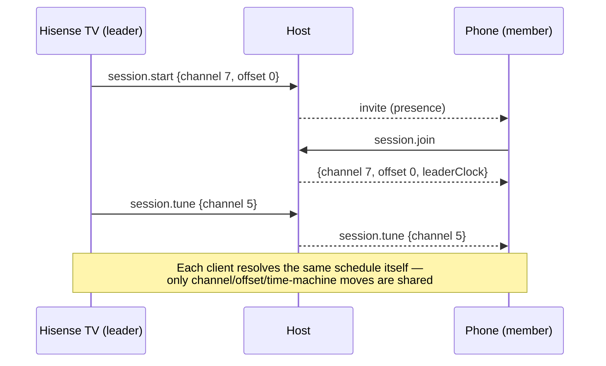

# 09 — Households, DVR and watching together

Status: proposed (P5). Depends on: C3 (05), C2 (02), 06 (events/presence), 01 (TV surfaces).
Owns contract **C5** (broadcast config vs. personal state).

## 1. Problem

- The app assumes one viewer. Favorites, viewing history, reminders, air checks, quick-jump
  slots and parental choices are box-wide. Several of these live in `channels.json`
  (`S.config.reminders`, `S.config.airChecks`, `ch.favorite`), so they are backed up, exported
  and undone alongside programming edits.
- Recording exists (tape deck, CH 101: ffmpeg cut-and-concat of what a channel broadcasts).
  Doc 11 added guide actions for immediate recording and future timers through that
  plugin. Household series recording and "My Shows" remain to be built.
- Every LAN viewer and TV client is an independent TV. Great for isolation, but there's no way
  to hand a program from the TV to a phone at the same moment, or to watch *together*.

## 2. Contract C5 — two stores

| Broadcast config (`channels.json`) | Personal store (`userData/profiles/<id>.json`) |
|---|---|
| Channels, content, schedule, programming, pool | Favorites, hidden-for-me channels, quick-jump slots |
| Box-wide presentation defaults, plugins | Viewing history (today its own file — moves under profile) |
| Parental **policy**: which ratings/channels are lockable, PIN | Parental **assignment**: which profile is restricted |
| Recording *storage* settings | Recording requests, series rules, resume points |
| — | Reminders, air checks, per-profile theme/era preference (usage **mode** stays per device, C1) |

Rules:
- Personal state never influences what airs; it only filters, marks or triggers client actions.
- Personal writes are commands with `scope: 'personal:<id>'` (05), synced only to clients
  signed in as that profile.
- Config backups exclude personal stores; profiles have their own export/import.
- The viewer projection never includes other profiles' stores.

Migration: `reminders`, `airChecks`, `ch.favorite`, `quickJumpSlots` and the viewing log move
into a default profile "Everyone" on first run of this version (config migration + profile file
creation), leaving broadcast config free of them.

## 3. Profiles

- **Who's watching** on TV power-on (skippable; "Everyone" default) and a profile switcher in
  the TV menu (01) and the web panel status bar (06).
- A profile has: name, avatar colour, optional PIN, **restriction level** (maps to parental
  policy ratings), favorites, theme/era preference, history.
- Restricted profiles:
  - locked channels are hidden from the guide and surfing (not just PIN-gated on tune);
  - EAS and core broadcast elements still show;
  - leaving the profile requires the PIN.
- Device default profile per client (the Hisense TV defaults to "Family", a laptop to "Zach").

## 4. DVR

Built on the tape deck's recorder and the pure schedule.

- **Record from anywhere a program appears**: guide (a program's actions — long-press OK on the remote, 11 §2.3 → Record), ON AIR
  (02), program search results, channel banner hub (01 §6.1).
- **Request types**: one airing; *series* (same series id on this channel, 07); *slot*
  (every Friday 8 PM on CH 67); *keyword* (library query).
- **Scheduling**: the host (06) expands requests into concrete airings using
  `querySchedule` (C2) over a rolling 14-day window, re-expanding on `configGeneration`
  change. Because the schedule is deterministic, a recording is really "capture channel N
  from t0 to t1", and the recorder can start at any time, even late: it cuts the same bytes
  from source files rather than capturing a live stream.
- **Breaks**: option per request — "as aired" (bumpers and ads included, the retro default)
  or "program only" (skip break windows from `breakEntriesInWindow`).
- **Storage**: host `recordings/` with quota and keep-policies (keep N episodes, delete after
  watched + 7 days); recordings are library items (`kind: 'recording'`, 07).
- **My Shows** (TV menu + web panel): per profile, resume points, watched state. Playback of
  a recording goes through CH 101 / tape deck playback on the single `#player` (invariant 5).
- **Conflicts**: none at capture level (files, not tuners), but keep a *simulated tuner
  limit* option (e.g. 2 tuners, era-accurate) that flags overlapping requests — purely a
  retro rule, off by default.

## 5. Handoff and resume

- "Continue on…" from the TV menu or phone remote: sends `{ channel, timeOffsetMs }` or a
  recording position to another client via a `client.handoff` event (06). The receiving client
  tunes to the same moment; the deterministic schedule guarantees it's the same frame (± load
  latency, already corrected by the first-frame catch-up from `ba32ac9`).
- Resume points for recordings and time-machine sessions live in the personal store.

## 6. Watching together

A **shared session** pins a group of clients to a common channel and `timeOffsetMs`.

- Shared: channel changes, time-machine moves, guide-driven tunes, optional reactions/chat
  overlay (party-channel's existing guest wall can be the overlay).
- Not shared: volume, captions, mode, profile.
- Drift: members compare the leader's wall-clock sample with their own and apply a
  `timeOffsetMs` correction; within ±250 ms is treated as in sync.
- Leaving a session restores the client's own channel and offset.
- Works across the LAN only (no internet relay; offline invariant).

## 7. Implementation phases

1. Personal store + migration of reminders/air checks/favorites/history into "Everyone".
2. Profiles UI (TV + web), restriction levels, guide filtering.
3. DVR requests + host expansion + record-from-guide; My Shows; retention.
4. Handoff events; resume points.
5. Shared sessions; reactions overlay.

## 8. Acceptance criteria

- Switching profile on the Hisense TV changes favorites, guide filtering and history within
  one second, without any programming change on other clients.
- A series request records every new airing for 14 days, including one that started before
  the request was made (captured from source files).
- Handoff from TV to phone lands within 1 s of the TV's position.
- Two clients in a shared session stay within ±250 ms across 10 channel changes.

## 9. Risks

- Migration moves user data between files. Mitigation: backups before migration, dual-read
  for one release.
- Restricted profiles on a LAN browser can be bypassed by a new session. Mitigation: profile
  choice on a client is tied to its paired session; creating a new session on a
  restriction-default device lands in the restricted profile.
- Recording disk usage: quotas and visible storage in System › Storage.
